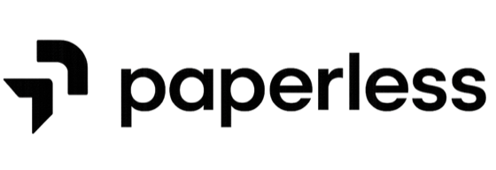
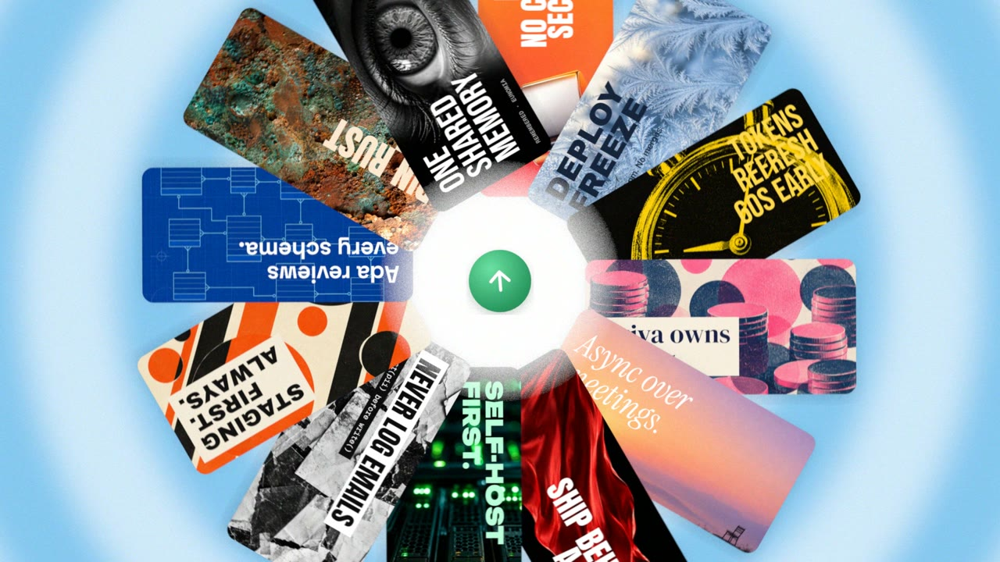

<div align="center">

<a href="https://www.buildpaperless.com.au/eunomia">
  <picture>
    <source media="(prefers-color-scheme: dark)" srcset="docs/images/paperless-logo-light.png">
    
  </picture>
</a>

# Eunomia

**Shared memory for the AI apps you already use.**

Tell one AI app something once, and every app you connect can remember it.
Eunomia keeps your people, projects, decisions and documents in one place that
you host and own, and lets ChatGPT, Claude, Claude Code, Codex and other AI apps
look things up there.

Free for personal and noncommercial use. Using it in a business needs a paid
licence ([below](#licence-and-support)).

[](https://github.com/Cashara-io/eunomia/actions/workflows/ci.yml)
[](https://github.com/Cashara-io/eunomia/releases/latest)
[](LICENSE)


**Install on Linux, macOS or WSL with one command:**

</div>

```bash
curl -fsSL https://www.buildpaperless.com.au/eunomia/install.sh | bash
```

<div align="center">

It installs Docker if it's missing, starts Eunomia and creates your account.
[Read the installer script](https://www.buildpaperless.com.au/eunomia/install.sh) ·
[What it does and its options](#install).

**[I already have an account](#connect-your-ai-app)** ·
**[I want to install it](#install)** ·
[Who can see what](#who-can-see-what) ·
[For admins](#for-admins) ·
[For developers](#for-developers) ·
[Docs](docs/README.md)

</div>

## See it in action

[](docs/media/eunomia-launch-film.mp4)

Watch the launch film (with sound) in [1080p](docs/media/eunomia-launch-film.mp4)
(27 MB) or [720p](docs/media/eunomia-launch-film-720p.mp4) (4 MB).

**New in 2.3.0:** the Ontology workspace brings your business model, objects, connections,
review queue and activity together. Chat can show diagrams from saved ontology evidence.
Composio connects selected Gmail, Google Drive and other supported app accounts to your memory.
Projects, shared spaces and the command-line tools are included in the same install.
Every release is described on the [releases page](https://github.com/Cashara-io/eunomia/releases).

---

# Using Eunomia

This part is for everyone, including people whose admin has already set Eunomia up.

## Connect your AI app

1. **Open Eunomia and pick your app on Home.** The choices are:
   - **ChatGPT**, the web or desktop app.
   - **Claude Code**, a coding terminal for developers.
   - **Codex**, a coding app or terminal.
   - **Other apps**, which covers the everyday **Claude** chat app, Cursor and more.

   Using Claude to chat (not to code)? Choose **Other apps**.
2. **Follow the steps for that app.** ChatGPT is set up in your browser. Claude Code and
   Codex need one command, and the guide shows how to open a command window on Mac,
   Windows or Linux.
3. **Sign in and approve.** Your app opens a page that asks **"Allow *app* to use
   Eunomia?"**. Read what it is asking for, then choose **Allow**.
4. **Try it.** In a new conversation, ask *"Use Eunomia to look for memories about me."*
   On a new account it finds nothing. That's normal: the connection works, there is
   just nothing saved yet.

If ChatGPT can't reach Eunomia, its guide gives you a message to send your admin.
ChatGPT connects from OpenAI's servers, so Eunomia needs a public `https://` address.
To disconnect an app later, go to **Settings → Connected apps**. Stuck? Every guide
links to **Connection help**.

## Try it

> Remember that Ada prefers async updates over meetings.

> In the Marketing space, remember that the launch moved to 12 March.

Then, in another conversation or another app:

> What do you know about Ada?

Your AI app saves to **your personal space** unless you name a space.

## Find your way around

| In the sidebar | What it's for |
|---|---|
| **Home** | What your team knows, invitations waiting for you, and connecting an AI app |
| **Chat** | Ask questions about your memories and documents in the app (needs an AI model, see [For admins](#ai-model)) |
| **People & topics** | Everyone and everything your AI apps remember. Its tabs: **List** (sortable), **Connections** (a graph of how they relate) and **Memory map** (every memory as a point, with similar ones close together, for one space or several) |
| **Memory spaces** | Your spaces, who is in them, invitations and sharing |
| **Documents** | Upload files (text, Markdown, JSON, CSV, text PDFs). Your AI apps can then search them |
| **Connected sources** | Bring in data from other apps (GitHub, Slack, Notion, Gmail…) |
| **Help** | The user guides, inside the app |
| **Settings** | Your account, API tokens, connected apps, and admin pages for admins |
| **Advanced → AI instructions, Code map** | What Eunomia tells AI apps about using it, and a map of code your agents have described |

Press **⌘K** (Ctrl K on Windows and Linux) to search everything.

## Memory spaces

A **memory space** keeps one part of your life or work together, such as your own
notes, a client, a project or a team. Everything your AI apps remember goes into a
space.

- **Your personal space** is created with your account.
- **Shared spaces** are for projects and teams. An owner invites people by email,
  and each person gets access when they choose **Join** under **Pending invitations**.
  Owners can invite people, change roles, rename or delete a space, or hand it over.
  Members can read and add memories. A space always keeps at least one owner.
- **Make a copy** creates a new space with the same memories, with only you in it.
  **Advanced: combine two spaces** (for owners and admins) merges two spaces into a
  new one and leaves both originals unchanged.
- **Share with another Eunomia.** An owner can create a one-time share code. Someone
  running their own Eunomia joins with it and keeps a full copy that stays in step
  over an encrypted link ([details](docs/peer-vaults.md)).

In the API and in agent tools, a memory space is called a **vault**.

## Who can see what

| What | Who can see it |
|---|---|
| **Your personal space** | Only you. The app has no option to share it. An agent can invite someone into it through the API, but records you import there still stay yours alone. |
| **A shared space** | Its members, after they join. Leaving or being removed takes effect immediately. |
| **Data you import** (Connected sources) | You, unless the source is set to file its records into a shared space. Then that space's members can read them, along with the facts drawn from them ([routing](docs/connectors.md#which-vault-records-go-to)). |
| **Admins** | Admins manage accounts and can read the workspace audit log: who changed which space, sign-ins and settings. Being an admin doesn't open your spaces. |
| **Another organisation** on the same server | Nothing. Each organisation's data is kept in its own database, and CI tests that one organisation can't read another's. |

The full rules, including what an agent token can reach, are in
[Concepts](docs/concepts.md#vaults).

## Bring in what you already have

- **Upload files** on the **Documents** page.
- **Connect a source** on **Connected sources**. Built in: GitHub, Linear, Notion,
  Todoist, Slack, Discord, Gmail, Google Calendar, Ed Discussion, PocketAI (meeting
  recordings and transcripts), and personal sources (Stripe, Up Bank, Spotify).
  Eunomia checks the connection first, shows where items will go, and reports progress.
- **Disconnect** stops importing and keeps what was already imported. **Remove and
  delete its data** is a separate step that asks you to confirm.

Source setup for admins is in [Connectors](docs/connectors.md).

---

# For admins

## Install

Runs on Linux and macOS (on Windows, inside WSL), on **amd64** and **arm64**
(including Apple Silicon and Raspberry Pi 4/5). It needs Docker with Compose, and the
installer can install it for you.

```bash
curl -fsSL https://www.buildpaperless.com.au/eunomia/install.sh | bash -s -- --dir ~/eunomia
```

**What the installer does:**
- It installs anything missing (git, curl, openssl, Docker, jq), asking first when it
  runs interactively. It uses Homebrew on macOS (with Colima for Docker) and your
  package manager on Linux.
- It puts Eunomia in `--dir`, which defaults to `./eunomia` in the current folder.
- It starts the database, backend, web app, updater and nightly backups.
- It creates your account and saves the password to `.eunomia-credentials`
  (readable only by you).
- It connects the AI apps it finds on this computer by writing their MCP settings.
  For Claude Code it also adds two hooks to `~/.claude/settings.json`. See
  [AI agents & MCP](docs/agents.md) for each app's file.
- It stops before changing anything if a port is taken.

Every option, and a manual install without the script, are in
[Installation](docs/installation.md). Running the installer again is safe.

Then open [localhost:3000](http://localhost:3000). **The first account is the admin.**
Restart your AI app so it loads Eunomia. For Claude Code, exit and run
`claude --continue`.

| Port | Serves | Reachable from |
|---|---|---|
| `3000` | The web app, plus `/mcp` for AI apps | Your network (plain http). Set `FRONTEND_BIND=127.0.0.1` to keep it on this machine. |
| `8001` | The API (the web app forwards to it) | This machine only |
| `80`, `443` | Only with built-in HTTPS (`--domain`) | The internet |

## Remote access and HTTPS

- **Built-in HTTPS:** `--domain eunomia.example.com --acme-email you@example.com`,
  or turn it on later in **Settings → HTTPS**. It needs DNS pointing at this machine
  and ports 80/443 open, and it gets a free Let's Encrypt certificate.
- **Your own reverse proxy** (Caddy, nginx, Traefik): see
  [Deployment](docs/deployment.md#your-own-reverse-proxy).
- **A private network** (Tailscale, a VPN) works for everything except ChatGPT,
  which needs a public `https://` address.

## Accounts, sign-in and security

- **Who can sign up:** anyone who can reach the server, by default (`SIGNUP=open`).
  This is so people you invite can create their account first. **Once your team has
  joined, set `SIGNUP=invite` (with `SIGNUP_ALLOWLIST`) or `closed`.**
- **Single sign-on:** OpenID Connect (Okta, Entra ID, Google, Keycloak, WorkOS and
  others) alongside passwords or instead of them (`AUTH_MODE=both` or `oidc`). SAML
  isn't supported yet. See [Single sign-on](docs/deployment.md#single-sign-on-openid-connect).
- **Settings → People:** every account in the workspace. Make or remove admins, and
  suspend or restore accounts. Suspending someone ends their sessions and stops their
  tokens and connected apps.
- **Settings → Audit log:** space changes, sign-ins and setting changes, written as
  sentences, with a failures-only filter and CSV export. Kept for 365 days
  (`AUDIT_RETENTION_DAYS`).
- **Tokens for agents** can be limited to read or save, to one space, and to an
  expiry date (90 days by default).
- **Admins** are the first account, any address in `EUNOMIA_ADMIN_EMAILS`, and anyone
  an admin promotes.

## Secrets and your data

- **`ENCRYPTION_KEY`** in `.env` encrypts connector credentials and protects each
  organisation's database password. **Keep a copy off the machine.** Without it the
  organisation databases can't be opened. See
  [Rotating ENCRYPTION_KEY](docs/deployment.md#rotating-encryption_key).
- **Password managers:** agents can use secrets from 1Password or Bitwarden Secrets
  Manager (preview) by reference, without seeing the values. When an agent needs a key
  nobody has stored, it asks a person in a pop-up. This is off until you turn it on
  under Connected sources. A space owner can register any item the provider token can
  read, so scope that token. See [Password managers](docs/password-managers.md).
- **AI model calls send content to that model.** The model you configure receives
  text from memories, documents and chat. A local model server (such as Ollama) keeps
  that text on your network.

## AI model

**You don't need one.** Connected AI apps use their own model to read and write
memories, and Eunomia's search works on text and links. Adding an OpenAI-compatible
endpoint in **Settings → AI provider** turns on:
- search by meaning;
- automatic extraction of people and facts;
- summaries;
- in-app Chat.

Local endpoints are allowed by default. Embeddings must have 1,536 dimensions. See
[AI agents & MCP](docs/agents.md#do-i-need-an-openai-key).

## Backups

- **Schedule:** the `backup` service saves an encrypted export of every database
  nightly at 03:00 (set `TZ` in `.env` for local time). It keeps 14 nightly and 8
  weekly copies in the `eunomia-backups` volume.
- **No failover:** Eunomia is a single machine with no standby copy. You can lose up to
  a day of changes.
- **Off-machine copies:** keep `.env` (it holds `ENCRYPTION_KEY` and
  `BACKUP_ENCRYPTION_KEY`) and copies of the backups somewhere else. Without
  `BACKUP_ENCRYPTION_KEY` the backups can't be read.

```bash
backend/scripts/backup.sh                    # back up now
backend/scripts/backup.sh list               # list backups
backend/scripts/restore.sh <backup> --wipe   # restore (the app is offline meanwhile)
scripts/restore-drill.sh                     # prove a backup restores, into a throwaway database
```

Run these from the install folder. **`docker compose down -v` deletes the database
and the backups on this machine.** Details are in
[Backups](docs/deployment.md#backups).

## Updating

**Settings → Updates → Update now.** Only admins see it. Eunomia checks for a new
release every 10 minutes. It restarts on the new release's prebuilt images in a few
seconds and runs any database changes itself.

- The update is done by an `updater` container that has the Docker socket and the
  install folder mounted, so it can restart the stack.
- It won't update over local edits to tracked files such as `docker-compose.yml`.
  Put your settings in `.env`.
- To update from a terminal, or to a specific version, run the installer again
  (`--ref vX.Y.Z`).
- **Coming from 1.x:** update with **Update now** as usual. Read
  [Upgrading to SurrealDB 3](docs/upgrading-to-surrealdb-3.md) first.

More in [Updates](docs/deployment.md#updates).

## Uninstall

```bash
cd ~/eunomia && docker compose down -v   # deletes the database and on-machine backups: copy them first
cd .. && rm -rf ~/eunomia
```

Then remove the `eunomia` entry from each AI app's MCP settings. The file for each app
is listed in [AI agents & MCP](docs/agents.md). For Claude Code, also remove:
- the two Eunomia hooks in `~/.claude/settings.json`;
- `~/.claude/skills/eunomia-memory`;
- `~/.config/eunomia`.

---

# For developers

## How it works


- **Stack:** a Rust backend, a Next.js web app and SurrealDB 3.
- **Data:** each organisation has its own database, reached with its own database user.
  Accounts, tokens, the audit log and the job queue live in a separate `control`
  database.
- **Background work:** imports, embeddings and fact extraction run as jobs that are
  retried if they fail.
- **Recall:** answers combine five ways of searching (meaning, keywords, memory text,
  graph links and dates) into one ranking.

See the [architecture](docs/architecture.md) and the
[interactive diagram](docs/diagrams/architecture.html) (download and open it locally).

## Connect agents and clients

- **MCP:** `<your Eunomia URL>/mcp`, using a personal access token or MCP OAuth 2.1.
- **REST:** `POST /api/tools/:name` with the same token. Both share one tool registry.
- **Install script:** supports Claude Code, Codex, Hermes, Gemini CLI, Cursor, Windsurf,
  OpenCode, VS Code and Claude Desktop (Claude Desktop needs Node).
- **Connect more later:** run `./scripts/connect-agents.sh`.
- **One space and shared skills per repo:** run `npm create eunomia` in it
  ([Projects](docs/projects.md)).

Every tool and its options are in [AI agents & MCP](docs/agents.md). For the
TypeScript SDK, see [SDK](docs/sdk.md).

## Develop locally

You need Rust, Bun and Docker.

```bash
cp .env.example .env     # then set ENCRYPTION_KEY to the output of: openssl rand -base64 32
./run.sh                 # SurrealDB in Docker, the backend on :8001, the web app on :3000
```

Run the checks:

```bash
(cd backend && cargo test --release)
(cd frontend && bun run lint && bun run build && bunx tsc --noEmit)
(cd frontend && E2E_BASE_URL=http://localhost:3000 bun run test)   # with the stack running
```

[Testing](docs/testing.md) covers every layer, including what CI runs: the backend
under hardened database settings, the proof that organisations are isolated, upgrades
from earlier releases, restore drills and the recall evaluation. Errors carry a stable
code and a trace id ([Errors](docs/errors.md), [Debugging](docs/debugging.md),
[Observability](docs/observability.md)).

## Documentation

| Guide | What it covers |
|---|---|
| [Quickstart](docs/quickstart.md) | Install, sign in and remember your first fact |
| [Installation](docs/installation.md) | Installer options, manual setup, platforms |
| [AI agents & MCP](docs/agents.md) | Agent setup, tokens, OAuth and every tool |
| [Concepts](docs/concepts.md) | Spaces (vaults), facts, observations, graphs and the memory map |
| [Connectors](docs/connectors.md) | Source credentials, sync and routing |
| [Deployment](docs/deployment.md) | HTTPS, settings, SSO, updates and backups |
| [Password managers](docs/password-managers.md) | 1Password and Bitwarden references, secret requests |
| [Sharing with another Eunomia](docs/peer-vaults.md) | Share codes and keeping copies in step |
| [Projects](docs/projects.md) | `npm create eunomia`: one space and shared skills per repo |
| [Architecture](docs/architecture.md) | Tenancy, jobs, ingestion, retrieval and access checks |

The user guides are also on the app's **Help** page and available to agents through
the `docs` tool. The full list is in the [docs index](docs/README.md).

## Licence and support

- **Licence:** licensed by Cashara Pty Ltd, trading as Paperless Labs. Free for personal and noncommercial use under the
  [PolyForm Noncommercial License 1.0.0](LICENSE). Any use inside a business needs a
  paid commercial licence. Releases up to v2.0.4 remain under the MIT licence.
- **Commercial licensing and support:**
  [developers@buildpaperless.com.au](mailto:developers@buildpaperless.com.au).
- **Bugs and feature requests:** [GitHub issues](https://github.com/Cashara-io/eunomia/issues).

Built by [Paperless Labs](https://www.buildpaperless.com.au/eunomia). © 2026 Cashara Pty Ltd, trading as Paperless Labs
