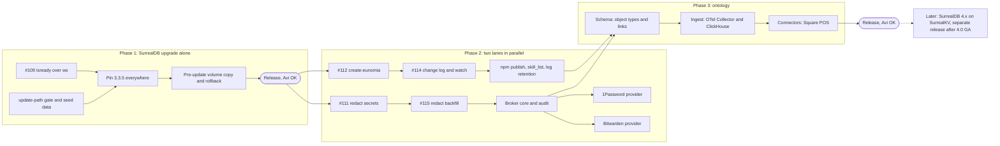

# Eunomia next release plan

Status: proposed 2026-10-31, nothing built yet. Base: `main` at 9a0820b (release 2.0.7, tag `v2.0.7`). Owner decisions that bind this plan: **SurrealDB stays the primary database** and **Rust stays** (both from [foundation-plan.md](foundation-plan.md)); the phase order below was agreed with Avi; **nothing merges without Avi's OK**. Open owner decisions are collected in section 9 and marked **DECISION FOR AVI** where they come up.

How this was made: one agent read the repo at 9a0820b (docs, CI, compose files, updater, migration runner, tests) and the open PRs (#109, #111, #112, #114, #115) and merged #102 with read-only `gh`. The external SurrealDB facts (3.3.5, 4.0.0-beta.1, the licence) were checked by the lead (the supervising agent) on 2026-10-31 against the surrealdb.com release notes and licence page, GitHub releases, crates.io and Docker Hub (the `v3.3.5` tag exists). The four workstreams and the phase order come from Avi. Every repo claim cites a path. Where something is inferred rather than read, it says "inferred". Facts that could not be confirmed are listed at the end.

## 1. The release, in one table

| # | Workstream | Phase | Size | Rough PRs | Touches migrations |
|---|---|---|---|---|---|
| 1 | SurrealDB 3.3.1 to 3.3.5, plus the update-path gate that every later PR uses | 1 | M | 4 | maybe one (index rebuild, only if the 3.3.x notes ask for it) |
| 2 | Eunomia Projects: finish steps 1 and 2 (#112, #114), then the remaining steps | 2 | M | 5 (2 open) | yes (#114 adds a tenant migration) |
| 3 | Enterprise password managers: 1Password and Bitwarden Secrets Manager through a credential broker | 2 | L | 6 (plus #111, #115 first) | yes (#115, plus broker tables) |
| 4 | Ontology foundation: SurrealDB object layer, ClickHouse events, OpenTelemetry Collector, Square POS connector | 3 | L | 8 | yes |



## 2. Avi's hard requirement: every PR is proven on the upgraded database and through the real update path

This section is part of every PR's definition of done, in every phase and every lane. A PR that cannot meet it does not merge.

1. **Tested against the upgraded SurrealDB.** Every PR runs green on the SurrealDB version the release ships (3.3.5 once Phase 1 lands): the in-memory engine of the pinned `surrealdb` crate (`backend/Cargo.toml`), and the real RocksDB server image in the Docker jobs.
2. **Migrations proven possible.** For any PR that adds or changes a file in `backend/migrations/`: forward migration from the released 2.0.7 schema with real-shaped seed data, an idempotent re-run (a second boot applies nothing and changes nothing), and a restore path (a pre-update backup restores and the previous release runs on it).
3. **Upgrading and updating proven possible.** An install on the previous release goes through the real update path to the PR's build, with data intact and every service healthy.

### 2.1 How an install updates today (what "the real update path" means)

Read from `scripts/auto-update.sh`, `scripts/updater.sh`, `docker-compose.yml` and `docs/releasing.md`:

- The `updater` compose service runs `scripts/auto-update.sh` every 20 seconds (`scripts/updater.sh`). "Update now" in Settings only drops `update-status/requested`; the backend never holds git or the docker socket.
- The script compares `EUNOMIA_IMAGE_TAG` in `.env` with the newest `v*` tag on GitHub (`git ls-remote --tags ... | sort -V | tail -1`), then `git fetch` and `git checkout` of that tag, rewrites `EUNOMIA_IMAGE_TAG`, adds missing keys (`BACKUP_ENCRYPTION_KEY`, `ENCRYPTION_KEY`, `JWT_SECRET`), runs the SurrealDB 3 hook only when the major changes from not-3 to 3, then `docker compose pull backend frontend backup` and `start_stack` (`docker compose up -d --remove-orphans`, retried with backoff for up to 30 minutes).
- `heal_stack` starts services left `Created` or exited after an interrupted update (the `heal` marker). A sibling `docker:27-cli` container recreates the `updater` itself a few seconds later.
- **The updater that runs is the OLD release's copy** (`docs/releasing.md`, first section). So a new release cannot rely on new updater logic; anything that must happen at update time has to happen at `docker compose up`, which is why the one-shot `surreal-upgrade` service exists (`scripts/surreal-upgrade-service.sh`).
- Releases: a `release/2.0.x` branch bumps `backend/Cargo.toml`, `backend/Cargo.lock` and `frontend/package.json` (commit 59604fb), merges to `main` by PR (#110), and the `v2.0.7` tag sits on the merge commit 9a0820b. Tags `v2.0.0` to `v2.0.7` exist; remote release branches are `release/2.0.6`, `release/2.0.7`, plus older `release-2.0.3`, `release-2.0.4`, `hotfix-2.0.1`, `hotfix-2.0.2`, `release/bridge`.
- Pushing any `v*` tag publishes images and moves `latest` (`.github/workflows/release.yml`). Because the updater offers the highest `v*` tag by `sort -V`, **a release-candidate tag pushed to GitHub would be offered to every install**. Confirmed by the lead: GNU `sort -V` on `v2.0.7 v2.1.0 v2.1.0-rc.1` gives `v2.0.7, v2.1.0, v2.1.0-rc.1`, so an rc tag sorts above its own final release and would keep outranking it after the release ships. Candidates must never be pushed as `v*` tags (risk R8).

What is proven today: the 2.x to 3.3 move with real containers (`scripts/tests/upgrade-surreal-v3.test.sh`, CI job `upgrade-surreal-v3`), the updater logic with a docker shim (`scripts/tests/auto-update.test.sh`), and both restore drills (`scripts/restore-drill.sh`, `scripts/restore-drill-tenancy.sh`, CI job `restore-drill`). What is not: **no CI job updates a 2.0.x install to the new build.** The `e2e` job builds fresh images and starts an empty stack. That gap is real: after the 2.0.6 update the live site returned 504 because the `http://` isready health check fails on the hardened 3.3.1 server once it holds data (#109), and no job caught it.

### 2.2 (a) The CI gate: a new `update-path` job

Added to `.github/workflows/ci.yml` next to `e2e`, `upgrade-surreal-v3` and `restore-drill`. It reuses their conventions: a throwaway compose project (`eu-update`, ports outside the 8211, 8231 and 8241 to 8249 slices already taken), `docker-compose.ci.yml` for the database port, `scripts/ci/e2e-setup.sh` for the first admin.

```yaml
  # An install on the previous release takes this PR's build through the real updater.
  update-path:
    needs: [frontend]
    runs-on: ubuntu-latest
    timeout-minutes: 40
    strategy:
      fail-fast: false
      matrix:
        from: [v2.0.7]          # the release candidate run widens this, see 2.3
    steps:
      - uses: actions/checkout@v4
        with: { fetch-depth: 0 }   # needs the old tags
      - run: bash scripts/tests/update-path.test.sh "${{ matrix.from }}"
      - uses: actions/upload-artifact@v4
        if: failure()
        with: { name: update-path-${{ matrix.from }}, path: update-path-artifacts/ }
```

`scripts/tests/update-path.test.sh <from-tag>` (new) does, in order:

1. **Build the candidate.** `docker compose build` of this checkout, then `docker tag` the three images as `ghcr.io/cashara-io/eunomia-{backend,frontend,backup}:v9.9.9-ci`. `v9.9.9-ci` is a local-only tag that sorts above every real release and is never pushed.
2. **A stand-in GitHub.** A local bare repo with the real tags up to `<from-tag>` plus `v9.9.9-ci` on this checkout's HEAD, as `scripts/tests/auto-update.test.sh` already does with `file://`.
3. **Install the old release for real.** `git clone --branch <from-tag>` from the stand-in into a temp dir, `.env` with fresh secrets and `EUNOMIA_IMAGE_TAG=<from-tag>`, then `docker compose up -d --wait` pulling the **published** `<from-tag>` images from ghcr. All services, including `backup` and `updater`.
4. **Seed real-shaped data** through the old release's own API, never raw SQL, with a new `scripts/ci/seed-install.sh`: two users in one org plus one in a second org, the personal and two shared vaults, entities of all six built-in kinds and two custom kinds (`backend/migrations/tenant/0016_custom_entity_kinds.surql`), facts, observations and a superseded fact, relations, skills, an uploaded document, the demo connector with stored credentials, a scoped PAT and an OAuth client, enough tool calls to fill `tool_usage` and `audit_log`, an extension, and finished and dead jobs. One memory carries a fake GitHub token so the redaction backfill (#115) has work to do once it lands.
5. **Snapshot.** Per-database, per-table row counts (the `row_counts` logic in `backend/scripts/backup/eunomia-backup.sh`), the `_migration` ledgers of `control` and each `org_*`, and a fixed set of reads: `recall` for five queries, `entity_get`, `skill_get`, `GET /api/audit/tool-usage`. Saved as JSON.
6. **Pre-update backup.** `docker compose run --rm --no-deps -T backup now pre-update`, the same entry point the 3.x move uses (`docs/upgrading-to-surrealdb-3.md`, step 3).
7. **Ask for the update as a user would.** `POST /api/update/request` as the admin (the backend writes `update-status/requested`), then run the OLD checkout's `scripts/auto-update.sh` on the host with `EUNOMIA_DIR` set (a supported mode, see the script header). Everything is real except one thing: a PATH shim turns `docker compose pull` into a no-op, because `v9.9.9-ci` exists only in the local daemon. Every other docker call goes to the real daemon.
8. **Assert the update.** `status.json` reports `current_version` `v9.9.9-ci` with no error; `history.log` has the `updated <from> -> v9.9.9-ci` line; `docker compose ps` shows every service running and healthy, nothing left `Created`; `/readyz` answers 200; the `surrealdb` container runs the new pin (`surrealdb/surrealdb:v3.3.5` after Phase 1).
9. **Assert the data.** Wait (bounded) until every org's ledger reaches `migrate::LATEST_TENANT` (the `migrate_tenant` jobs, `docs/architecture/tenancy.md`). Then: every table's count equals the snapshot or differs only where a migration in this PR says it should (the PR lists those tables); the fixed reads match the snapshot; no response carries `tenant.schema_behind`.
10. **Idempotent re-run.** Run `auto-update.sh` again (no-op, still on `v9.9.9-ci`), then `docker compose restart backend` and `docker compose up -d` (no recreate, no new ledger rows, counts unchanged).
11. **Playwright on the upgraded stack.** The `e2e` job's own steps against this stack: `bunx playwright test` with `E2E_BASE_URL=http://localhost:3000` and the env from `scripts/ci/e2e-setup.sh`. Specs that need an empty install skip themselves via a new `E2E_UPGRADED=1` flag (inferred: `signup.spec.ts` and `onboarding-connect.spec.ts` assume a first user).
12. **Rollback drill.** `git checkout <from-tag>`, set `EUNOMIA_IMAGE_TAG=<from-tag>`, restore the data volume copy (section 4.3) or, for a PR without an engine change, restore `pre-update` with `eunomia-backup restore ... --wipe`; `docker compose up -d --wait`; the step-5 counts and reads match exactly.

Cost: about 15 to 25 minutes per `from` tag (inferred from the current `e2e` and `upgrade-surreal-v3` timeouts of 25 minutes). It runs on every PR into `main` for `from: [v2.0.7]` only.

Two gaps in today's CI that the gate depends on:

- **Stacked PRs get no CI.** `ci.yml` runs on `pull_request: branches: [main]`, so #114 (base `feat/create-eunomia`) and #115 (base `feat/redact-secrets`) have never run it (the #115 body says so). Add `workflow_dispatch` to `ci.yml` so the lead can run the full workflow on any branch, and require one green run on the PR's head before review.
- **Pins drift.** The SurrealDB version is written in at least seven places (section 4.1). Extend `scripts/ci/check-release-order.sh`, which already compares the compose pin's major with the crate's, to fail when any pin's full version differs, and run it in the `scripts` job on every PR, not only at release.

### 2.3 (b) The release-candidate upgrade matrix

Run by the lead on the `release/2.x.y` branch before asking Avi for the release, via `workflow_dispatch` with a wider matrix:

| From | Why | Expected |
|---|---|---|
| fresh install | the one-line installer path | healthy, empty, `LATEST_TENANT` |
| `v2.0.7` | the current release | the full `update-path` assertions |
| `v2.0.6` | skips one release; tenant schema 0020 and control 0006 (`git diff v2.0.6 v2.0.7 -- backend/migrations` adds only `tenant/0021_skills.surql`); its compose file still has the `http://` isready check from before #109 | the full assertions, and every org passes through `tenant.schema_behind` and out of it (2.0.6 orgs sit two or more versions below the new `LATEST_TENANT`, below `MIN_SUPPORTED_TENANT = LATEST_TENANT - 1` in `backend/src/migrate.rs`) |
| `v2.0.7` with `UPGRADE_TEST_LARGE=1`-style data | timing on a big install (50k 1536-dimension rows, as in `upgrade-surreal-v3.test.sh`) | finishes inside the updater's 30-minute `UP_RETRY_FOR`; time recorded in the PR |
| `v2.0.7` on `linux/arm64` | `release.yml` ships arm64; the updater path has never run there in CI | same as `v2.0.7` |

After the tag is pushed and `release.yml` has published, a short **post-publish smoke** repeats the `v2.0.7` row with the real ghcr images and no pull shim. **DECISION FOR AVI:** whether `release.yml` should stop moving `latest` on tag push until that smoke is green (today `latest` moves at once).

### 2.4 (c) PR checklist template

`.github/pull_request_template.md` does not exist yet (checked). Proposed content, to add in Phase 1's first PR:

```markdown
## What and why

<!-- One paragraph. Link the lane spec and the issue. -->

## Definition of done (all boxes, or say why not)

### Tested on the release's SurrealDB
- [ ] `cargo clippy --all-targets -- -D warnings` and `cargo nextest run` green on the pinned crate (`backend/Cargo.toml`)
- [ ] `TEST_HARDENED=1 cargo nextest run` and `ISOLATION_TEST_NO_APP_FILTERS=1 cargo nextest run --test isolation` green
- [ ] CI green on this PR's head (stacked PR: one `workflow_dispatch` run of CI on the branch, linked here)
- [ ] `scripts/ci/check-release-order.sh` pin check passes (every SurrealDB pin agrees)

### Migrations (skip only if this PR adds no file under `backend/migrations/`)
- [ ] Holds the migration lock: number `____` in set `control` / `tenant`, reserved in `backend/migrations/QUEUE.md`
- [ ] Registered in `MIGRATIONS` or `CONTROL_MIGRATIONS` (`backend/src/migrate.rs`); new tables in `store::TENANT_TABLES` or `store::CONTROL_TABLES`
- [ ] `DEFINE ... OVERWRITE`; expand then contract; schema N-1 still served
- [ ] Schema snapshot updated (`migrations__fresh_schema_matches_snapshot`)
- [ ] Forward from 2.0.7 with seed data: `update-path` job green; tables whose counts change are listed here: ____
- [ ] Idempotent: second boot applies nothing (step 10 of `update-path`)
- [ ] Restore: rollback drill green (step 12 of `update-path`)

### Update path
- [ ] `update-path` job green (2.0.7 install, real updater, data intact, all services healthy)
- [ ] New or changed compose services start under an old updater's plain `docker compose up -d` (no new updater logic relied on)
- [ ] New `.env` keys have safe defaults when absent

### Safety
- [ ] No secret value in logs, spans, audit rows, change-log rows, capsules or test snapshots
- [ ] Isolation suite covers any new table (canary row in `backend/tests/isolation.rs`)
- [ ] Docs updated (`docs/`), Australian English, no em or en dashes

### Review
- [ ] Lead reviewed against the lane spec
- [ ] Avi's OK to merge: ____
```

## 3. Orchestration: lanes, worktrees, the migration lock

### 3.1 Lanes

| Lane | Branch prefix | Owns | Phase |
|---|---|---|---|
| Lead | `docs/`, `release/` | specs, reviews, the migration queue, release branches, the RC matrix | all |
| L1 Surreal | `upgrade/surreal-` | section 4 | 1 |
| L2 Projects | `feat/projects-` (and the open `feat/create-eunomia`, `feat/project-changes`) | section 5 | 2 |
| L3 Broker | `feat/broker-` (and the open `feat/redact-secrets`, `feat/redact-backfill`) | section 6 | 2 |
| L4 Ontology | `feat/ontology-` | section 7 | 3 |

- One Claude Code session per lane, each in its own worktree: `git worktree add ../eu-<lane> -b <branch> origin/main`. Worktrees share the stash stack, so lanes never use bare `git stash`; they make WIP commits.
- Each lane starts from a short written spec by the lead, `docs/architecture/specs/<lane>.md` (goal, non-goals, files it may touch, migrations it needs, the tests that prove it, open questions). The lane does not start coding until Avi has read the spec.
- The lead reviews every PR against its spec and the checklist in 2.4, runs the stacked-PR CI by `workflow_dispatch`, and keeps one integration branch per phase rebased on `main` to catch cross-lane conflicts early.
- **Nothing merges without Avi's OK.** The lead asks with a one-paragraph summary, the CI links and the `update-path` result.

### 3.2 Only one lane writes migrations at a time

How numbering works today (`backend/migrations/README.md`, `backend/src/migrate.rs`): two sets, `control/NNNN_name.surql` and `tenant/NNNN_name.surql`, each numbered contiguously from 0001 and listed by number in `CONTROL_MIGRATIONS` or `MIGRATIONS`. `LATEST_TENANT` is the last entry; `MIN_SUPPORTED_TENANT` is one below it. An applied file's checksum is frozen. Main is at control 0006 and tenant 0021.

Collisions already happened twice: #92 and #102 both wrote control `0005` (#102's body; resolved as `0005_tool_usage` and `0006_oidc_identity`), and today #114 (`0022_changes`) and #115 (`0022_redact_backfill`) both claim tenant `0022` (#115's body says whichever merges second renumbers).

Proposal, a queue file plus a lock:

1. `backend/migrations/QUEUE.md`, owned by the lead, one line per reserved number: `set | number | name | lane | PR | state` (state: `reserved`, `locked`, `merged`).
2. A lane reserves a number by asking the lead, who adds the line in a docs-only commit on `main` (Avi's OK covers it with the spec). Numbers are handed out in merge order, not in start order.
3. **The lock**: only the lane whose line is `locked` may have an unmerged migration file in an open PR that is up for merge. Others may draft migrations locally against their reserved number but rebase and renumber if the queue moves.
4. The lock passes when the locked PR merges (`merged`) or is parked (line removed). Only then does the next lane rebase on `main`, take the lock, regenerate the schema snapshot and rerun `update-path`.
5. A CI check in the `scripts` job (new, small): the numbers in `MIGRATIONS` and `CONTROL_MIGRATIONS` are contiguous and unique, every file is registered, and every file not on `main` is in `QUEUE.md` as `locked` for this branch.
6. Prefer one tenant migration per release. Each extra one widens the window in which orgs migrated last answer `tenant.schema_behind` (inferred from `MIN_SUPPORTED_TENANT`). If a release needs several, the lead says so to Avi and the RC matrix proves the window closes.

Initial queue for this release, in proposed merge order:

| Set | Number | Name | Lane | PR |
|---|---|---|---|---|
| tenant | 0022 | `redact_backfill` | L3 | #115 |
| tenant | 0023 | `changes` | L2 | #114 (renumber from 0022) |
| tenant | 0024 | `credential_refs` | L3 | broker core |
| control | 0007 | `secret_providers` (if Avi picks the control database, see 6.3) | L3 | broker core |
| tenant | 0025 | `ontology_core` | L4 | ontology schema |

**DECISION FOR AVI:** #115 or #114 first. The order above puts the redaction backfill first because the broker depends on it and it fixes plaintext secrets already stored; #114 then only renumbers one file, its `migrate.rs` entry and the snapshot.

## 4. Workstream 1: SurrealDB upgrade (Phase 1)

### 4.1 Target

- Today: crate `surrealdb = "=3.3.1"` with features `protocol-ws` and `kv-mem` (`backend/Cargo.toml`), server image `surrealdb/surrealdb:v3.3.1` on RocksDB (`docker-compose.yml`, `rocksdb:/data/eunomia.db`).
- Latest stable is 3.3.5 (GitHub release 2026-10-29). 3.3.4 (2026-10-13) fixed queries returning wrong rows (decimal and regex comparisons in indexed scans, among others). 3.2.6 is the 3.2 maintenance patch and not relevant to us.
- **Recommendation: 3.3.5 now.** It is a patch on the same 3.3 line and the same RocksDB engine, so no storage conversion; it carries the 3.3.4 correctness fix; and SurrealDB's own 4.0 guide says to be on the latest 3.3 before 4.0. **DECISION FOR AVI: 3.3.x now (recommended) vs 4.x.** 4.x is section 4.4.
- **DECISION FOR AVI:** ship Phase 1 alone as `2.0.8`, or hold it for the feature release. Recommended: alone, so an engine regression is never mixed up with a feature regression.

Every pin to move together (from a grep of 9a0820b):

| Where | Pin |
|---|---|
| `backend/Cargo.toml`, `backend/Cargo.lock` | crate `=3.3.1` |
| `docker-compose.yml` | `surrealdb/surrealdb:v3.3.1` (and the 3.3.1 comments on the flags) |
| `backend/scripts/backup/Dockerfile` | `FROM surrealdb/surrealdb:v3.3.1 AS surreal` (the backup CLI) |
| `.github/workflows/ci.yml` | the `Job claims across processes` container |
| `scripts/restore-drill.sh`, `scripts/restore-drill-tenancy.sh` | `fw-backup-db` image |
| `scripts/tests/upgrade-surreal-v3.test.sh` | `NEW_IMG` |
| `scripts/tests/upgrade-surreal-v3-import.test.sh`, `-down.test.sh`, `check-release-order.test.sh` | mock strings |
| `run.sh` | local dev server |
| `backend/tests/jobs.rs`, `docs/testing.md`, `docs/surrealql-3.md` | doc comments |

### 4.2 Work

1. **Re-verify the hardened flags on 3.3.5.** The `--deny-all` plus `--allow-*` set and "`--deny-guests` is a startup error with `--deny-all`" were verified on 3.3.1 (`docker-compose.yml` comments, foundation-plan.md). Repeat on 3.3.5, including the `--allow-funcs` list (`docs/architecture/surreal-functions.md`) and `--allow-experimental=files` for document buckets.
2. **Read the 3.3.2 to 3.3.5 release notes for index rebuild instructions.** The 3.3.4 fix is in indexed scans. If the notes say existing indexes may hold wrong entries, add a tenant migration that rebuilds them (`REBUILD INDEX`), which then takes the migration lock. Not known yet.
3. **Re-run the upgrade suite with `NEW_IMG=v3.3.5`.** An install that was moved from 2.x lands straight on 3.3.5.
4. **Run Spike S2's recall goldens and `recall-eval.spec.ts`** on 3.3.5: the floors must hold (the 3.3.4 change touches comparisons that recall's filters use, inferred).

### 4.3 Rollback for a patch upgrade

Today a 3.3.1 to 3.3.5 update takes **no** backup: the 2.0.7 updater only runs its hook when the major goes from not-3 to 3 (`scripts/auto-update.sh`), and the nightly `backup` export can be up to a day old. Foundation-plan.md records that 3.3+ refuses downgrades; whether 3.3.1 can open a RocksDB directory that 3.3.5 has written is not verified. So rollback must not depend on it.

Proposal: generalise the one-shot `surreal-upgrade` service (it runs at every `docker compose up`, so the old updater triggers it):

- Record the pinned server version in `.env` (`SURREAL_SERVER_VERSION`) after a healthy start.
- When the compose pin differs from the recorded version, copy the data volume to `eunomia-surreal-data-v3-pre-<old version>` before `surrealdb` starts, and keep it until the next successful release. Plus an encrypted `pre-<version>` export once the new server is up (the export format from 3.3.5 must restore into 3.3.1 for this to be a rollback; test it).
- The `update-path` rollback step (2.2, step 12) uses that copy: old tag, old image, old volume.
- Disk: one extra copy of the volume. Report free space in `status.json` and refuse with a clear message when there is not enough (the 3.x move already plans for 4 times, `docs/upgrading-to-surrealdb-3.md`).

### 4.4 Later, as its own release: SurrealDB 4.x on SurrealKV

Not in this release. 4.0.0-beta.1 (2026-10-28) is a pre-release. What it changes for us:

| 4.0 change | What it means for Eunomia |
|---|---|
| RocksDB removed; SurrealKV 1.0 is the only on-disk engine. `rocksdb://` paths open with SurrealKV and convert on first start | Every install converts, so plan it like the 2.x to 3.x move |
| Conversion is **one-way**: once 4.0 opens a datastore, no 3.x release starts on it | Never let 4.0 open the live volume. Convert a copy with `skv migrate <rocksdb-dir> <surrealkv-dir>` (leaves the original), plus an export first, keep the RocksDB volume for one release as rollback |
| Needs room for a second copy; `/health` answers only after conversion | Check free disk; the compose health check and the backend's `start_period` need a longer first start |
| 3.x Rust SDKs refuse a 4.0 server; upgrade SDKs before server | Same shape as the 2.x to 3.x split (`docs/releasing.md`): the backend crate and the server pin must move in one release, and `check-release-order.sh` must learn major 4 |
| Rust SDK: `kv-rocksdb` becomes `kv-surrealkv` | We do not use `kv-rocksdb`; we use `kv-mem` for tests and `protocol-ws` for the server (`backend/Cargo.toml`). Check that `kv-mem` stays in 4.x |
| Clusters: go to latest 3.3 first | Phase 1 does this |
| Rebuild some HNSW indexes (JACCARD, PEARSON) and full-text indexes with records updated then deleted | Our HNSW is COSINE (`tenant/0008_v3_indexes.surql`), so likely not affected; our FULLTEXT indexes on title, body_text and memory text see updates and deletes all the time, so plan a rebuild migration |
| Exact float and decimal comparison, `SPLIT` naming, KNN in `UPDATE`/`DELETE`, writes that create a table | Grep our statements in `backend/src/store/` and the `every_query_executes` test; `STRICT` org databases already refuse implicit table creation |
| `SURREAL_ROCKSDB_*` settings ignored | We set none (grep of `docker-compose.yml`) |

The 2.0.x updater only knows the 3.x hook, so a 4.x release needs a compose-level one-shot like `surreal-upgrade` that converts a copy and records the new volume. `MIGRATE EXISTING ROWS` is reported for 4.x but was not found in the 4.0.0-beta.1 notes; verify before any plan relies on it. Self-hosted multi-node SurrealDB needs the paid Enterprise edition; not needed now (no sharding).

### 4.5 Phase 1 PRs

| PR | Lane | Depends on | Migrations |
|---|---|---|---|
| P1.1 #109 isready over `ws://` (open), rebased and run on 3.3.5 | L1 | none | no |
| P1.2 `update-path` job, `scripts/tests/update-path.test.sh`, `scripts/ci/seed-install.sh`, pin check, `workflow_dispatch`, `.github/pull_request_template.md` | L1 with lead | none | no |
| P1.3 Pin 3.3.5 everywhere (table in 4.1), flags re-verified, recall floors | L1 | P1.1, P1.2 | only if 4.2 step 2 says so |
| P1.4 Pre-update volume copy and version record in `surreal-upgrade` (4.3), rollback drill | L1 | P1.2 | no |
| Release `release/2.0.8` and RC matrix (2.3) | Lead | all above | no |

## 5. Workstream 2: Eunomia Projects (Phase 2, lane L2)

The 2.0.5 Projects proposal is not in the repo or in the issue and PR bodies searched (`Projects`, `ontology`). The lead read the `v2.0.5` release notes: they cover only the move to Cashara-io/eunomia, the ghcr images, the installer and the PolyForm licence change, with no Projects content. The proposal was reviewed with Avi outside the repo. The steps below come from #112, #114 and `docs/projects.md` on `feat/project-changes`.

**Lead task:** commit the proposal as `docs/architecture/specs/projects.md`, so the L2 lane spec has a source in the repo before step 3 starts.

A project ties a repo to one vault: `.eunomia/eunomia.toml` names the server and vault, `.eunomia/skills/` holds skills, and every agent working in the repo shares that vault.

| Step | State | What |
|---|---|---|
| 1 `create-eunomia` | #112 open, base `main` | `cli/create-eunomia` (Node 18+, no runtime deps): `npm create eunomia` init (sign in, pick or create a vault, mint a vault-scoped `memory:write` token stored in `~/.config/eunomia/projects/`), `sync` of skills via `skill_save`. CI: the `scripts` job builds and tests it on Node 18. No migration |
| 2 change log and `watch` | #114 open, stacks on #112 | tenant migration `0022_changes` (to renumber, 3.2): numbered per-vault change rows without content, `GET /api/vaults/{vault}/changes`, a WebSocket, the `changes_since` MCP tool, `create-eunomia watch` |
| 3 publish | not started | publish `create-eunomia` to npm (#112: "can only be tried after publishing"); a `release.yml` job with npm provenance, gated on Avi's OK. **DECISION FOR AVI:** npm org and package owner |
| 4 `skill_list` | not started | a server `skill_list` tool, so sync's "only on the server" list stops being a best-effort 50-result search (#112) |
| 5 change log operations | not started | retention or pruning (#114: "never pruned"), and a shared bus for several backend replicas (#114: in-process broadcast; other replicas arrive within 5 seconds by polling) |
| 6 project ontology | not started | "the entity kinds the vault uses" (`docs/projects.md`, "Coming next"). This is the seam to Phase 3: it should be built on the ontology schema (7.2), not separately |

Notes for the lane:

- #112 and #114 were tested against the published `v2.0.7` backend image (#112) and locally (#114), not on 3.3.5 and not through `update-path`. Both must pass the section 2 gate after Phase 1.
- #114's `0022_changes` touches many write paths (`entities/service.rs`, `entities/consolidate.rs`, `documents/`, `tools/registry/skills.rs`) and raises the `round_trips` ceilings; it overlaps #115's edits to `store/cache.rs`, `store/mod.rs`, `tools/registry/skills.rs` and `provisioning/legacy.rs` (file lists of both PRs). Expect textual conflicts; the lead merges them in queue order.
- The change log carries `actor` but no content (#114), which suits the broker: a secret resolution is never a vault change.

Size: M. PRs: #112, #114, then 3 more (steps 3, 4, 5); step 6 moves to Phase 3.

## 6. Workstream 3: enterprise password managers through a credential broker (Phase 2, lane L3)

### 6.1 Goal

Agents and connectors use secrets held in the customer's 1Password or Bitwarden Secrets Manager without Eunomia ever storing the plaintext. Eunomia stores only **references**; the broker resolves a reference at tool-call time, hands the value to the one outbound call that needs it, and logs that it did.

Supported in this release:

- **1Password Connect server** (self-hosted Connect container with a Connect token, REST API).
- **1Password service accounts** (a service account token). Which client to use from Rust is open: as far as this research found there is no official 1Password Rust SDK, so the options are the `op` CLI in a sidecar or a small sidecar on one of the official SDKs (to verify).
- **Bitwarden Secrets Manager** (a machine account access token). Its SDK core is written in Rust (to verify the crate, its stability and its licence before depending on it).

### 6.2 What exists to build on

- One tool registry and one audit choke point: `registry::call` (`backend/src/tools/registry/mod.rs`). Non-read-only calls write an `audit_log` row (tenant, `0001_baseline.surql`: owner, `tool_name`, `args_summary`, `outcome`, `created_at`); every call is counted in `tool_usage` (control `0005_tool_usage`, merged in #102, counts and metadata only, by person, credential, channel, MCP session and tool, shown in Settings, Usage).
- The append-only `audit_event` table in control (foundation-plan.md, phase 7).
- Connector credentials are stored AES-256-GCM encrypted (`backend/src/connectors/crypto.rs`). The broker does not replace that; it adds a second, reference-only kind of credential.
- Redaction (#111, open): known secret shapes are replaced by `[redacted: <kind>]` in memory and skill writes, the audit row and failure capsules. #115 (open, stacks on #111) backfills rows written before #111. **Both merge before the broker**, because redaction is the backstop if a resolved value ever reaches memory.

### 6.3 Design

- **References.** `op://<vault>/<item>/<field>` (1Password's own format). For Bitwarden, a Eunomia-defined `bws://<secret-id>` (inferred: Bitwarden addresses secrets by id; the scheme is ours). A reference is a string in a tool argument or a connector setting, for example `{"$secret": "op://Ops/Square/access_token"}`.
- **What is stored.** Tenant table `credential_ref`: reference, provider, vault, allowed tools, allowed actors, created by, created at. No value, ever. The provider's own bootstrap secret (Connect token, service account token, machine account token) is the one secret Eunomia must hold. **DECISION FOR AVI:** keep it out of the database (`.env` or a Docker secret, recommended for self-host) or store it encrypted in control like connector credentials (`control/0007_secret_providers`).
- **Resolution.** In `registry::call`, after `authorize()` and before the tool runs: find `$secret` references in the arguments, check the reference is allowed for this vault, tool and actor, resolve it, and pass the value only to the outbound request. The value never enters the arguments that are summarised, audited, captured in capsules or logged. Zeroise after use. A short in-memory cache (seconds, per process) is optional and off by default.
- **Audit of every resolution.** Who (user, token or OAuth client), which reference, which tool, which channel and MCP session, outcome (`ok`, `denied`, `not_found`, `provider_error`), trace id, time; **never the value**. Proposed as a new append-only kind in `audit_event` (`secret.resolve`), plus a per-reference count in Settings next to the tool-usage view. Lives in the same place as #102's usage report so admins see one audit surface.
- **Backstop.** The broker knows the exact values it resolved during a call, so it scrubs those exact strings from the tool's result before the result returns to the agent or reaches any memory write in the same request. #111's shape detectors stay underneath. Add detectors for the providers' own token shapes (1Password service account tokens and Bitwarden access tokens; exact prefixes to verify) and bump `redact::DETECTOR_VERSION` so #115's backfill picks them up.
- **Failure.** A failed resolution fails the tool call with a stable error code (`secret.unavailable`, added to `docs/errors.md`), never a fallback to a stored value.

### 6.4 Tests

- A mock 1Password Connect and a mock Bitwarden API in the Playwright mocks style (`E2E_MOCK_HOST`), plus unit tests on reference parsing.
- Canary test: resolve a canary value, call a tool that echoes it, then assert it appears in no `audit_log`, `audit_event`, `tool_usage`, capsule, span, log line, change-log row or memory (extends `backend/tests/isolation.rs`'s `NO_SECRET_ROWS` idea from #114).
- Isolation: org A's references never resolve for org B; a vault-restricted token cannot resolve a reference bound to another vault.
- The section 2 gate: `update-path` from 2.0.7 with the broker tables new and empty.

### 6.5 Competitors

Avi named two competitors Eunomia is trying to beat: **Island** (island.io), an enterprise browser with built-in credential and data controls, and **Wonderful** (wonderful.ai), an enterprise AI agents platform. The point for this workstream: enterprise buyers expect their secrets to stay in their own password manager, with an audit trail of every use. The broker gives exactly that (references only, resolution at call time, every resolution audited) while Eunomia stays the shared memory and tool layer that teams' existing agents connect to over MCP (PRODUCT.md), not a secret store.

### 6.6 PRs

| PR | Lane | Depends on | Migrations |
|---|---|---|---|
| #111 redact secrets (open) | L3 | Phase 1 | no |
| #115 redact backfill (open) | L3 | #111 | tenant 0022 |
| B1 broker core: references, `credential_ref`, resolution in `registry::call`, `audit_event` kind, exact-value scrub | L3 | #115 | tenant 0024 (and control 0007 if chosen) |
| B2 1Password Connect provider | L3 | B1 | no |
| B3 1Password service accounts provider (sidecar or CLI, per 6.1) | L3 | B1 | no (maybe a compose service: must pass the old-updater `up` rule) |
| B4 Bitwarden Secrets Manager provider | L3 | B1 | no |
| B5 Settings UI: providers, references, resolution log | L3 | B1 | no |

Size: L. 7 PRs including the two open ones.

## 7. Workstream 4: ontology foundation (Phase 3, lane L4)

### 7.1 Shape

Modelled on Palantir Foundry's layers: source connectors, datasets, transforms, an indexed object layer, and governed actions with writeback. This release builds the first three and the object layer; actions and writeback come later.

| Layer | Store | Notes |
|---|---|---|
| Object types, objects, links | SurrealDB (per-org database, as today) | RELATE edges as links |
| Events and time series | ClickHouse | one row per event, joined to the object by its SurrealDB record id as a string key column (`asset:abc`) |
| Ingest from many machines | OpenTelemetry Collector | OTLP in, ClickHouse out |
| Later | ClickHouse Keeper (replication), HyperDX or ClickStack (UI) | not this release |
| Not now | sharding | single node |

DuckDB was considered and rejected: it is embedded with a single writer, so it cannot take many concurrent machine streams.

### 7.2 Phase 3a: schema (SurrealDB)

- **Stable core types are `SCHEMAFULL`**, like every table today. **Types that change shape are flexible**: for example `asset` is a `SCHEMAFULL` table with core fields (`vault`, `subtype`, `name`, `created_at`, `updated_at`) and one `props` field `TYPE object FLEXIBLE` for subtype attributes, so vans, planes, trucks and boats are asset subtypes without new tables. Subtype attribute schemas are rows in an `object_type` table, validated by the app.
- **Links** are a `links` relation table (`TYPE RELATION`), with the link type as a field, like `relates_to` in `tenant/0016_custom_entity_kinds.surql`.
- **Customer-defined names never become table or field definitions.** That is already the rule for custom entity kinds (0016: "a kind name comes from an agent, so it never becomes a table name"), it fits `STRICT` org databases, and it matters for the licence (7.5).
- **DECISION FOR AVI:** objects as a new layer beside memory entities, linked to them (recommended: widen `memory.subject` so a memory can be about an object), or objects as an extension of the existing `entity` table.
- Projects step 6 (the vault's entity kinds) is built here.

### 7.3 Phase 3b: ingest (OpenTelemetry Collector and ClickHouse)

- Two new compose services behind a profile (`ontology`), off by default, the same way `caddy` sits behind `https`. An old updater's `docker compose up -d --remove-orphans` must leave an install without the profile exactly as it was; `update-path` proves both profile off and profile on.
- ClickHouse table sketch: `events(ts DateTime64, org String, object_id String, event_type LowCardinality(String), source LowCardinality(String), attrs JSON)` (inferred: `JSON` or `Map(String, String)` depending on the ClickHouse version we pin), `ORDER BY (org, object_id, ts)`, monthly partitions.
- The Collector receives OTLP (gRPC and HTTP), maps resource attributes to `org` and `object_id`, and writes with the contrib ClickHouse exporter. It is the only service that publishes a port for machines; it needs per-org ingest tokens (**DECISION FOR AVI:** reuse PATs with a new `ingest:write` scope, recommended, or separate keys).
- Tenancy in ClickHouse: per-org database or one table with `org` and row policies. **DECISION FOR AVI**; the isolation suite must cover it either way.
- Backups and restore: the `backup` service and both restore drills must include ClickHouse before 3b merges, or the hard requirement's restore path is not met.
- ClickHouse has its own upgrade path, so pin an exact version, as for SurrealDB.

### 7.4 Phase 3c: first connector, Square POS

A food truck's tills: payments, orders, catalog and locations through Square's APIs and webhooks.

- Built on the existing source connector pattern (`backend/src/sources/base.rs`, `registry.rs`, `routing.rs`; `stripe.rs` is the nearest analogue) and connector routing to vaults.
- Mapping: Square locations and catalog items become objects (a truck is an `asset` with subtype `truck`, linked to its location); orders and payments become ClickHouse events keyed by those object ids.
- Webhooks verified by Square's HMAC signature header (to verify the exact scheme against Square's docs in the lane spec), rate-limited by the existing webhook limit (`RATE_LIMIT_WEBHOOK_PER_MIN`).
- The Square access token is the broker's first real customer: a `op://` or `bws://` reference instead of a stored token, which ties Phase 2 to Phase 3.
- Tests against Square's sandbox in a manual check, and against an in-test mock in CI (as `connectors-sync.spec.ts` does).

### 7.5 Licence

SurrealDB's core is BSL 1.1 with an Additional Use Grant that allows any use except running SurrealDB as a database service for third parties who create and manage their own schemas or tables (https://surrealdb.com/license). [Foundation-plan.md](foundation-plan.md) (section 1, "Licence check") says Eunomia's users never touch schemas, so this is fine, and adds: "never expose raw SurrealQL or schema control to customers". It also notes the licence converts to Apache 2.0 on 2030-01-01. The ontology's customer-defined types are the first feature that comes near that line (inferred risk), even with types stored as rows rather than `DEFINE` statements. **DECISION FOR AVI: a legal check before 3a merges, and before any hosted or SaaS offering.** Eunomia itself is PolyForm Noncommercial.

### 7.6 PRs

| PR | Lane | Depends on | Migrations |
|---|---|---|---|
| O1 ontology spec (lead) and licence check | Lead | Phase 2 merged | no |
| O2 schema: `object_type`, `asset` and core types, `links`, tools to define and read them | L4 | O1 | tenant 0025 |
| O3 project ontology in `create-eunomia` (Projects step 6) | L2 or L4 | O2 | no |
| O4 compose `ontology` profile: ClickHouse and OTel Collector, pinned | L4 | O2 | no (compose only) |
| O5 ingest auth, tenancy and query tools over ClickHouse | L4 | O4 | maybe control (ingest scope) |
| O6 backup and restore drills cover ClickHouse | L4 | O4 | no |
| O7 Square connector: locations, catalog, orders, payments, webhooks | L4 | O5, B1 | maybe tenant (connector settings) |
| O8 docs and a food truck walkthrough | L4 | O7 | no |

Size: L. About 8 PRs.

## 8. All PRs by phase

| Phase | PR | Lane | Depends on | Touches migrations |
|---|---|---|---|---|
| 1 | #109 isready over ws | L1 | none | no |
| 1 | P1.2 update-path gate, seed, pin check, PR template | L1, lead | none | no |
| 1 | P1.3 3.3.5 pins | L1 | #109, P1.2 | maybe (index rebuild) |
| 1 | P1.4 pre-update volume copy | L1 | P1.2 | no |
| 2 | #112 create-eunomia | L2 | Phase 1 | no |
| 2 | #114 change log and watch | L2 | #112, #115 (queue) | tenant 0023 |
| 2 | P2.3 npm publish | L2 | #112 | no |
| 2 | P2.4 skill_list | L2 | #112 | no |
| 2 | P2.5 change log retention and bus | L2 | #114 | maybe |
| 2 | #111 redact secrets | L3 | Phase 1 | no |
| 2 | #115 redact backfill | L3 | #111 | tenant 0022 |
| 2 | B1 broker core and audit | L3 | #115 | tenant 0024, maybe control 0007 |
| 2 | B2, B3, B4 providers | L3 | B1 | no |
| 2 | B5 Settings UI | L3 | B1 | no |
| 3 | O1 to O8 | L4 (O1 lead) | Phase 2 | O2 tenant 0025; O5, O7 maybe |

Total: about 23 PRs, 4 of them already open. Rough effort: Phase 1 about 1.5 weeks, Phase 2 about 3 weeks with the two lanes in parallel, Phase 3 about 4 to 5 weeks (inferred, same scale as foundation-plan.md's estimates).

## 9. Risks and open decisions for Avi

| # | Risk or decision | Impact | Proposal |
|---|---|---|---|
| D1 | **3.3.x now vs 4.x** | 4.x converts storage one way and is a pre-release | **3.3.5 now**; 4.x as its own release after 4.0 GA, behind an export and `skv migrate` on a copy |
| D2 | Ship Phase 1 alone as 2.0.8? | Mixing engine and feature regressions | Yes, alone |
| D3 | Merge order of #115 and #114 (both tenant 0022) | One must renumber | #115 first, #114 becomes 0023 |
| D4 | Stop `release.yml` moving `latest` until the post-publish smoke passes | A bad release reaches "Update now" at once | Yes |
| D5 | Where the password manager bootstrap token lives | It is the one secret the broker must hold | `.env` or Docker secret, not the database |
| D6 | 1Password service accounts from Rust | No official Rust SDK found | Sidecar; decide in the B3 spec |
| D7 | npm owner for `create-eunomia` | Publishing step | Cashara-io npm org |
| D8 | Objects beside entities or inside `entity` | Shapes Phase 3 and Projects step 6 | Beside, linked through `memory.subject` |
| D9 | ClickHouse tenancy: database per org or row policies | Isolation proof | Database per org, to match SurrealDB |
| D10 | **SurrealDB licence and customer-defined types** | BSL Additional Use Grant excludes third-party schema control | Legal check before O2 merges and before any SaaS |
| R1 | A 3.3.1 server may not open data written by 3.3.5 | Rollback by downgrade fails | Volume copy before the new server starts (4.3) |
| R2 | Stacked PRs never ran CI | Merged untested on the real server | `workflow_dispatch`, one green run required |
| R3 | `update-path` uses a pull shim | The one step that differs from production | Post-publish smoke with real images |
| R4 | Several tenant migrations in one release | Longer `tenant.schema_behind` window for 2.0.6 installs | One per release where possible; RC matrix row from 2.0.6 |
| R5 | ClickHouse and the Collector add the first new stateful services since `backup` | One-curl install grows; backups must cover them | Profile off by default; O6 before O7 |
| R6 | Resolved secrets leak into memory through tool output | Plaintext at rest | Exact-value scrub, then #111 detectors, then #115 backfill |
| R7 | CI time grows by about 20 minutes per PR | Slower loop | `update-path` for 2.0.7 only per PR; the full matrix only at RC |
| R8 | A pushed `v*-rc` tag sorts above its own final release under `sort -V` (confirmed) | Every install is offered the rc, and it keeps outranking the real release | Never push `v*-rc` tags; optionally make `auto-update.sh` ignore pre-release suffixes, which only helps installs once they run that updater |

## 10. Not confirmed

- The 2.0.5 Projects proposal: not in the repo or in the issue and PR bodies searched; the `v2.0.5` release notes (read by the lead) have no Projects content. It was reviewed with Avi outside the repo; section 5 is built from #112, #114 and `docs/projects.md` on `feat/project-changes` until the lead commits it as `docs/architecture/specs/projects.md`.
- Whether the 3.3.2 to 3.3.5 notes require an index rebuild, and whether 3.3.1 starts on data 3.3.5 has written.
- That the hardened flag set behaves the same on 3.3.5 as on 3.3.1.
- That `kv-mem` remains available in the 4.x Rust SDK; `MIGRATE EXISTING ROWS` in 4.x (reported, not in the 4.0.0-beta.1 notes).
- 1Password Rust support, Bitwarden SDK crate and licence, both providers' token prefixes, and Square's webhook signature details.
- Which Playwright specs need an empty install (`E2E_UPGRADED` skip list, inferred).
