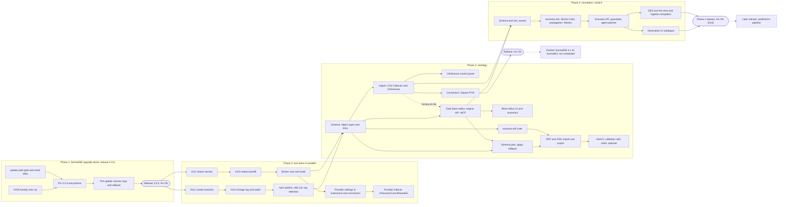

# Eunomia next release plan

Status: proposed 2026-10-31; decisions D1, D2, D5, D7, D9, D10 recorded 2026-10-31 and D3 on 2026-11-01 (section 10). Phase 1 is in progress as the 2.0.8 patch release (branch `release/2.0.8`); nothing else is built yet. Base: `main` at 9a0820b (release 2.0.7, tag `v2.0.7`). Owner decisions that bind this plan: **SurrealDB stays the primary database** and **Rust stays** (both from [foundation-plan.md](foundation-plan.md)); the phase order below was agreed with Avi; **nothing merges without Avi's OK**. Owner decisions, made and open, are collected in section 10; open ones are marked **DECISION FOR AVI** where they come up, and decided ones say **Decided 2026-10-31**.

How this was made: one agent read the repo at 9a0820b (docs, CI, compose files, updater, migration runner, tests) and the open PRs (#109, #111, #112, #114, #115) and merged #102 with read-only `gh`. The external SurrealDB facts (3.3.5, 4.0.0-beta.1, the licence) were checked by the lead (the supervising agent) on 2026-10-31 against the surrealdb.com release notes and licence page, GitHub releases, crates.io and Docker Hub (the `v3.3.5` tag exists). The four workstreams and the phase order come from Avi. Every repo claim cites a path. Where something is inferred rather than read, it says "inferred". Workstream 5 (simulation / what-if, Phase 4) was added by Avi on 2026-10-31, with its research in [specs/simulation-research.md](specs/simulation-research.md). Facts that could not be confirmed are listed in section 11.

## 1. The release, in one table

| # | Workstream | Phase | Size | Rough PRs | Touches migrations |
|---|---|---|---|---|---|
| 1 | SurrealDB 3.3.1 to 3.3.5, plus the update-path gate that every later PR uses; ships alone as patch release 2.0.8 | 1 | M | 4 | yes (tenant 0022, HNSW index rebuild, decided 2026-11-01) |
| 2 | Eunomia Projects: finish steps 1 and 2 (#112, #114), then the remaining steps | 2 | M | 5 (2 open) | yes (#114 adds a tenant migration) |
| 3 | Enterprise password managers: 1Password and Bitwarden Secrets Manager through a credential broker and a provider sidecar | 2 | L | 4 (plus #111, #115) | yes (#115, plus broker tables) |
| 4 | Ontology foundation: SurrealDB object layer, self-hosted ClickHouse events with an in-app control panel, OpenTelemetry Collector, Square POS connector, data and schema blast radius (plan, apply, rollback), RDF and OWL import and export | 3 | L (upper end) | 15 | yes |
| 5 | Simulation / what-if: five engines (propagation, Markov, DES, ABM, SD) inside Monte Carlo runs, baseline vs A/B scenarios, an allow-listed generative UI; on assumptions, not trained models (predictions are a later release) | 4 | L (upper end); XL with wave 2 | 16 (S16 later) | yes (one tenant migration plus a ClickHouse table, S1) |



## 2. Avi's hard requirement: every PR is proven on the upgraded database and through the real update path

This section is part of every PR's definition of done, in every phase and every lane. A PR that cannot meet it does not merge.

1. **Tested against the upgraded SurrealDB.** Every PR runs green on the SurrealDB version the release ships (3.3.5 once Phase 1 lands): the in-memory engine of the pinned `surrealdb` crate (`backend/Cargo.toml`), and the real RocksDB server image in the Docker jobs.
2. **Migrations proven possible.** For any PR that adds or changes a file in `backend/migrations/`: forward migration from the released 2.0.7 schema with real-shaped seed data, an idempotent re-run (a second boot applies nothing and changes nothing), and a restore path (a pre-update backup restores and the previous release runs on it).
3. **Upgrading and updating proven possible.** An install on the previous release goes through the real update path to the PR's build, with data intact and every service healthy.

### 2.1 How an install updates today (what "the real update path" means)

Read from `scripts/auto-update.sh`, `scripts/updater.sh`, `docker-compose.yml` and `docs/releasing.md`:

- The `updater` compose service runs `scripts/auto-update.sh` every 20 seconds (`scripts/updater.sh`). "Update now" in Settings only drops `update-status/requested`; the backend never holds git or the docker socket.
- The script compares `EUNOMIA_IMAGE_TAG` in `.env` with the newest `v*` tag on GitHub (`git ls-remote --tags ... | sort -V | tail -1`), then `git fetch` and `git checkout` of that tag, rewrites `EUNOMIA_IMAGE_TAG`, adds missing keys (`BACKUP_ENCRYPTION_KEY`, `ENCRYPTION_KEY`, `JWT_SECRET`), runs the SurrealDB 3 hook only when the major changes from not-3 to 3, then `docker compose pull backend frontend backup` and `start_stack` (`docker compose up -d --remove-orphans`, retried with backoff for up to 30 minutes).
- `heal_stack` starts services left `Created` or exited after an interrupted update (the `heal` marker). A sibling `docker:27-cli` container recreates the `updater` itself a few seconds later.
- **The updater that runs is the OLD release's copy** (`docs/releasing.md`, first section). So a new release cannot rely on new updater logic; anything that must happen at update time has to happen at `docker compose up`, which is why the one-shot `surreal-upgrade` service exists (`scripts/surreal-upgrade-service.sh`).
- Releases: a `release/2.0.x` branch bumps `backend/Cargo.toml`, `backend/Cargo.lock` and `frontend/package.json` (commit 59604fb), merges to `main` by PR (#110), and the `v2.0.7` tag sits on the merge commit 9a0820b. Tags `v2.0.0` to `v2.0.7` exist; remote release branches are `release/2.0.6`, `release/2.0.7`, plus older `release-2.0.3`, `release-2.0.4`, `hotfix-2.0.1`, `hotfix-2.0.2`, `release/bridge`.
- Pushing any `v*` tag publishes images and moves `latest` (`.github/workflows/release.yml`). Because the updater offers the highest `v*` tag by `sort -V`, **a release-candidate tag pushed to GitHub would be offered to every install**. Confirmed by the lead: GNU `sort -V` on `v2.0.7 v2.1.0 v2.1.0-rc.1` gives `v2.0.7, v2.1.0, v2.1.0-rc.1`, so an rc tag sorts above its own final release and would keep outranking it after the release ships. Candidates must never be pushed as `v*` tags (risk R8).

What is proven today: the 2.x to 3.3 move with real containers (`scripts/tests/upgrade-surreal-v3.test.sh`, CI job `upgrade-surreal-v3`), the updater logic with a docker shim (`scripts/tests/auto-update.test.sh`), and both restore drills (`scripts/restore-drill.sh`, `scripts/restore-drill-tenancy.sh`, CI job `restore-drill`). What is not: **no CI job updates a 2.0.x install to the new build.** The `e2e` job builds fresh images and starts an empty stack. That gap is real: after the 2.0.6 update the live site returned 504 because the `http://` isready health check fails on the hardened 3.3.1 server once it holds data (#109), and no job caught it.

### 2.2 (a) The CI gate: a new `update-path` job

Added to `.github/workflows/ci.yml` next to `e2e`, `upgrade-surreal-v3` and `restore-drill`. It reuses their conventions: a throwaway compose project (`eu-update`, ports outside the 8211, 8231 and 8241 to 8249 slices already taken), `docker-compose.ci.yml` for the database port, `scripts/ci/e2e-setup.sh` for the first admin.

```yaml
  # An install on the previous release takes this PR's build through the real updater.
  update-path:
    needs: [frontend]
    runs-on: ubuntu-latest
    timeout-minutes: 40
    strategy:
      fail-fast: false
      matrix:
        from: [v2.0.7]          # the release candidate run widens this, see 2.3
    steps:
      - uses: actions/checkout@v4
        with: { fetch-depth: 0 }   # needs the old tags
      - run: bash scripts/tests/update-path.test.sh "${{ matrix.from }}"
      - uses: actions/upload-artifact@v4
        if: failure()
        with: { name: update-path-${{ matrix.from }}, path: update-path-artifacts/ }
```

`scripts/tests/update-path.test.sh <from-tag>` (new) does, in order:

1. **Build the candidate.** `docker compose build` of this checkout, then `docker tag` the three images as `ghcr.io/cashara-io/eunomia-{backend,frontend,backup}:v9.9.9-ci`. `v9.9.9-ci` is a local-only tag that sorts above every real release and is never pushed.
2. **A stand-in GitHub.** A local bare repo with the real tags up to `<from-tag>` plus `v9.9.9-ci` on this checkout's HEAD, as `scripts/tests/auto-update.test.sh` already does with `file://`.
3. **Install the old release for real.** `git clone --branch <from-tag>` from the stand-in into a temp dir, `.env` with fresh secrets and `EUNOMIA_IMAGE_TAG=<from-tag>`, then `docker compose up -d --wait` pulling the **published** `<from-tag>` images from ghcr. All services, including `backup` and `updater`.
4. **Seed real-shaped data** through the old release's own API, never raw SQL, with a new `scripts/ci/seed-install.sh`: two users in one org plus one in a second org, the personal and two shared vaults, entities of all six built-in kinds and two custom kinds (`backend/migrations/tenant/0016_custom_entity_kinds.surql`), facts, observations and a superseded fact, relations, skills, an uploaded document, the demo connector with stored credentials, a scoped PAT and an OAuth client, enough tool calls to fill `tool_usage` and `audit_log`, an extension, and finished and dead jobs. One memory carries a fake GitHub token so the redaction backfill (#115) has work to do once it lands.
5. **Snapshot.** Per-database, per-table row counts (the `row_counts` logic in `backend/scripts/backup/eunomia-backup.sh`), the `_migration` ledgers of `control` and each `org_*`, and a fixed set of reads: `recall` for five queries, `entity_get`, `skill_get`, `GET /api/audit/tool-usage`. Saved as JSON.
6. **Pre-update backup.** `docker compose run --rm --no-deps -T backup now pre-update`, the same entry point the 3.x move uses (`docs/upgrading-to-surrealdb-3.md`, step 3).
7. **Ask for the update as a user would.** `POST /api/update/request` as the admin (the backend writes `update-status/requested`), then run the OLD checkout's `scripts/auto-update.sh` on the host with `EUNOMIA_DIR` set (a supported mode, see the script header). Everything is real except one thing: a PATH shim turns `docker compose pull` into a no-op, because `v9.9.9-ci` exists only in the local daemon. Every other docker call goes to the real daemon.
8. **Assert the update.** `status.json` reports `current_version` `v9.9.9-ci` with no error; `history.log` has the `updated <from> -> v9.9.9-ci` line; `docker compose ps` shows every service running and healthy, nothing left `Created`; `/readyz` answers 200; the `surrealdb` container runs the new pin (`surrealdb/surrealdb:v3.3.5` after Phase 1).
9. **Assert the data.** Wait (bounded) until every org's ledger reaches `migrate::LATEST_TENANT` (the `migrate_tenant` jobs, `docs/architecture/tenancy.md`). Then: every table's count equals the snapshot or differs only where a migration in this PR says it should (the PR lists those tables); the fixed reads match the snapshot; no response carries `tenant.schema_behind`.
10. **Idempotent re-run.** Run `auto-update.sh` again (no-op, still on `v9.9.9-ci`), then `docker compose restart backend` and `docker compose up -d` (no recreate, no new ledger rows, counts unchanged).
11. **Playwright on the upgraded stack.** The `e2e` job's own steps against this stack: `bunx playwright test` with `E2E_BASE_URL=http://localhost:3000` and the env from `scripts/ci/e2e-setup.sh`. Specs that need an empty install skip themselves via a new `E2E_UPGRADED=1` flag (inferred: `signup.spec.ts` and `onboarding-connect.spec.ts` assume a first user).
12. **Rollback drill.** `git checkout <from-tag>`, set `EUNOMIA_IMAGE_TAG=<from-tag>`, restore the data volume copy (section 4.3) or, for a PR without an engine change, restore `pre-update` with `eunomia-backup restore ... --wipe`; `docker compose up -d --wait`; the step-5 counts and reads match exactly.

Cost: about 15 to 25 minutes per `from` tag (inferred from the current `e2e` and `upgrade-surreal-v3` timeouts of 25 minutes). It runs on every PR into `main` for `from: [v2.0.7]` only.

Two gaps in today's CI that the gate depends on:

- **Stacked PRs get no CI.** `ci.yml` runs on `pull_request: branches: [main]`, so #114 (base `feat/create-eunomia`) and #115 (base `feat/redact-secrets`) have never run it (the #115 body says so). Add `workflow_dispatch` to `ci.yml` so the lead can run the full workflow on any branch, and require one green run on the PR's head before review.
- **Pins drift.** The SurrealDB version is written in at least seven places (section 4.1). Extend `scripts/ci/check-release-order.sh`, which already compares the compose pin's major with the crate's, to fail when any pin's full version differs, and run it in the `scripts` job on every PR, not only at release.

### 2.3 (b) The release-candidate upgrade matrix

Run by the lead on the `release/2.x.y` branch before asking Avi for the release, via `workflow_dispatch` with a wider matrix:

| From | Why | Expected |
|---|---|---|
| fresh install | the one-line installer path | healthy, empty, `LATEST_TENANT` |
| `v2.0.7` | the current release | the full `update-path` assertions |
| `v2.0.6` | skips one release; tenant schema 0020 and control 0006 (`git diff v2.0.6 v2.0.7 -- backend/migrations` adds only `tenant/0021_skills.surql`); its compose file still has the `http://` isready check from before #109 | the full assertions, and every org passes through `tenant.schema_behind` and out of it (2.0.6 orgs sit two or more versions below the new `LATEST_TENANT`, below `MIN_SUPPORTED_TENANT = LATEST_TENANT - 1` in `backend/src/migrate.rs`) |
| `v2.0.7` with `UPGRADE_TEST_LARGE=1`-style data | timing on a big install (50k 1536-dimension rows, as in `upgrade-surreal-v3.test.sh`) | finishes inside the updater's 30-minute `UP_RETRY_FOR`; time recorded in the PR |
| `v2.0.7` on `linux/arm64` | `release.yml` ships arm64; the updater path has never run there in CI | same as `v2.0.7` |

After the tag is pushed and `release.yml` has published, a short **post-publish smoke** repeats the `v2.0.7` row with the real ghcr images and no pull shim. **DECISION FOR AVI:** whether `release.yml` should stop moving `latest` on tag push until that smoke is green (today `latest` moves at once).

### 2.4 (c) PR checklist template

`.github/pull_request_template.md` does not exist yet (checked). Proposed content, to add in Phase 1's first PR:

```markdown
## What and why

<!-- One paragraph. Link the lane spec and the issue. -->

## Definition of done (all boxes, or say why not)

### Tested on the release's SurrealDB
- [ ] `cargo clippy --all-targets -- -D warnings` and `cargo nextest run` green on the pinned crate (`backend/Cargo.toml`)
- [ ] `TEST_HARDENED=1 cargo nextest run` and `ISOLATION_TEST_NO_APP_FILTERS=1 cargo nextest run --test isolation` green
- [ ] CI green on this PR's head (stacked PR: one `workflow_dispatch` run of CI on the branch, linked here)
- [ ] `scripts/ci/check-release-order.sh` pin check passes (every SurrealDB pin agrees)

### Migrations (skip only if this PR adds no file under `backend/migrations/`)
- [ ] Holds the migration lock: number `____` in set `control` / `tenant`, reserved in `backend/migrations/QUEUE.md`
- [ ] Registered in `MIGRATIONS` or `CONTROL_MIGRATIONS` (`backend/src/migrate.rs`); new tables in `store::TENANT_TABLES` or `store::CONTROL_TABLES`
- [ ] `DEFINE ... OVERWRITE`; expand then contract; schema N-1 still served
- [ ] Schema snapshot updated (`migrations__fresh_schema_matches_snapshot`)
- [ ] Forward from 2.0.7 with seed data: `update-path` job green; tables whose counts change are listed here: ____
- [ ] Idempotent: second boot applies nothing (step 10 of `update-path`)
- [ ] Restore: rollback drill green (step 12 of `update-path`)

### Update path
- [ ] `update-path` job green (2.0.7 install, real updater, data intact, all services healthy)
- [ ] New or changed compose services start under an old updater's plain `docker compose up -d` (no new updater logic relied on)
- [ ] New `.env` keys have safe defaults when absent

### Safety
- [ ] No secret value in logs, spans, audit rows, change-log rows, capsules or test snapshots
- [ ] Isolation suite covers any new table (canary row in `backend/tests/isolation.rs`)
- [ ] Docs updated (`docs/`), Australian English, no em or en dashes

### Review
- [ ] Lead reviewed against the lane spec
- [ ] Avi's OK to merge: ____
```

## 3. Orchestration: lanes, worktrees, the migration lock

### 3.1 Lanes

| Lane | Branch prefix | Owns | Phase |
|---|---|---|---|
| Lead | `docs/`, `release/` | specs, reviews, the migration queue, release branches, the RC matrix | all |
| L1 Surreal | `upgrade/surreal-` | section 4 | 1 |
| L2 Projects | `feat/projects-` (and the open `feat/create-eunomia`, `feat/project-changes`) | section 5 | 2 |
| L3 Broker | `feat/broker-` (and the open `feat/redact-secrets`, `feat/redact-backfill`) | section 6 | 2 |
| L4 Ontology | `feat/ontology-` | section 7 | 3 |
| L5 Simulation | `feat/sim-` (inferred) | section 8 | 4 |

- One Claude Code session per lane, each in its own worktree: `git worktree add ../eu-<lane> -b <branch> origin/main`. Worktrees share the stash stack, so lanes never use bare `git stash`; they make WIP commits.
- Each lane starts from a short written spec by the lead, `docs/architecture/specs/<lane>.md` (goal, non-goals, files it may touch, migrations it needs, the tests that prove it, open questions). The lane does not start coding until Avi has read the spec.
- The lead reviews every PR against its spec and the checklist in 2.4, runs the stacked-PR CI by `workflow_dispatch`, and keeps one integration branch per phase rebased on `main` to catch cross-lane conflicts early.
- **Nothing merges without Avi's OK.** The lead asks with a one-paragraph summary, the CI links and the `update-path` result.

### 3.2 Only one lane writes migrations at a time

How numbering works today (`backend/migrations/README.md`, `backend/src/migrate.rs`): two sets, `control/NNNN_name.surql` and `tenant/NNNN_name.surql`, each numbered contiguously from 0001 and listed by number in `CONTROL_MIGRATIONS` or `MIGRATIONS`. `LATEST_TENANT` is the last entry; `MIN_SUPPORTED_TENANT` is one below it. An applied file's checksum is frozen. Main is at control 0006 and tenant 0021.

Collisions already happened twice: #92 and #102 both wrote control `0005` (#102's body; resolved as `0005_tool_usage` and `0006_oidc_identity`), and today #114 (`0022_changes`) and #115 (`0022_redact_backfill`) both claim tenant `0022` (#115's body says whichever merges second renumbers).

Proposal, a queue file plus a lock:

1. `backend/migrations/QUEUE.md`, owned by the lead, one line per reserved number: `set | number | name | lane | PR | state` (state: `reserved`, `locked`, `merged`).
2. A lane reserves a number by asking the lead, who adds the line in a docs-only commit on `main` (Avi's OK covers it with the spec). Numbers are handed out in merge order, not in start order.
3. **The lock**: only the lane whose line is `locked` may have an unmerged migration file in an open PR that is up for merge. Others may draft migrations locally against their reserved number but rebase and renumber if the queue moves.
4. The lock passes when the locked PR merges (`merged`) or is parked (line removed). Only then does the next lane rebase on `main`, take the lock, regenerate the schema snapshot and rerun `update-path`.
5. A CI check in the `scripts` job (new, small): the numbers in `MIGRATIONS` and `CONTROL_MIGRATIONS` are contiguous and unique, every file is registered, and every file not on `main` is in `QUEUE.md` as `locked` for this branch.
6. Prefer one tenant migration per release. Each extra one widens the window in which orgs migrated last answer `tenant.schema_behind` (inferred from `MIN_SUPPORTED_TENANT`). If a release needs several, the lead says so to Avi and the RC matrix proves the window closes.

Initial queue for this release, in proposed merge order:

| Set | Number | Name | Lane | PR |
|---|---|---|---|---|
| tenant | 0022 | `rebuild_vector_indexes` (HNSW rebuild on `memory`, `skill`, `cache_record` after 3.3.5) | L1 | #119 (release 2.0.8) |
| tenant | 0023 | `changes` | L2 | #114 (renumber from 0022) |
| tenant | 0024 | `redact_backfill` | L3 | #115 (renumber from 0022) |
| tenant | 0025 | `credential_refs` (references, plus the encrypted provider settings, see 6.3) | L3 | broker core |
| tenant | 0026 | `ontology_core` | L4 | ontology schema |
| tenant | (0027) | `ontology_change` (blast radius scenarios, change records, backups) | L4 | O10, O12; only if not folded into 0026 (7.8) |
| tenant | (next free) | `simulation_core` (`assumption`, `edge_rule`, `state_model`, `scenario_run`, and the shared `scenario` fields, D15) | L5 | S1 (8.10) |

The control `0007_secret_providers` line from the first draft is gone: under D5 the provider token is stored with the org's connector credentials, not in control (6.3).

**Decided 2026-11-01 (D3):** #114 first, then #115, reversing this plan's first proposal. The HNSW index rebuild in #119 (4.2 step 2) takes 0022 because 2.0.8 merges first, so #114 renumbers to 0023 and #115 to 0024, and the broker and ontology numbers move up one. The live queue is `backend/migrations/QUEUE.md` (added in #119).

## 4. Workstream 1: SurrealDB upgrade (Phase 1)

### 4.1 Target

- Today: crate `surrealdb = "=3.3.1"` with features `protocol-ws` and `kv-mem` (`backend/Cargo.toml`), server image `surrealdb/surrealdb:v3.3.1` on RocksDB (`docker-compose.yml`, `rocksdb:/data/eunomia.db`).
- Latest stable is 3.3.5 (GitHub release 2026-10-29). 3.3.4 (2026-10-13) fixed queries returning wrong rows (decimal and regex comparisons in indexed scans, among others). 3.2.6 is the 3.2 maintenance patch and not relevant to us.
- **Decided 2026-10-31 (D1): 3.3.5 now.** It is a patch on the same 3.3 line and the same RocksDB engine, so no storage conversion; it carries the 3.3.4 correctness fix; and SurrealDB's own 4.0 guide says to be on the latest 3.3 before 4.0. 4.x is parked (section 4.4).
- **Decided 2026-10-31 (D2): Phase 1 ships now, alone, as the small patch release `2.0.8`** (branch `release/2.0.8`), so an engine regression is never mixed up with a feature regression.

Every pin to move together (from a grep of 9a0820b):

| Where | Pin |
|---|---|
| `backend/Cargo.toml`, `backend/Cargo.lock` | crate `=3.3.1` |
| `docker-compose.yml` | `surrealdb/surrealdb:v3.3.1` (and the 3.3.1 comments on the flags) |
| `backend/scripts/backup/Dockerfile` | `FROM surrealdb/surrealdb:v3.3.1 AS surreal` (the backup CLI) |
| `.github/workflows/ci.yml` | the `Job claims across processes` container |
| `scripts/restore-drill.sh`, `scripts/restore-drill-tenancy.sh` | `fw-backup-db` image |
| `scripts/tests/upgrade-surreal-v3.test.sh` | `NEW_IMG` |
| `scripts/tests/upgrade-surreal-v3-import.test.sh`, `-down.test.sh`, `check-release-order.test.sh` | mock strings |
| `run.sh` | local dev server |
| `backend/tests/jobs.rs`, `docs/testing.md`, `docs/surrealql-3.md` | doc comments |

### 4.2 Work

1. **Re-verify the hardened flags on 3.3.5.** The `--deny-all` plus `--allow-*` set and "`--deny-guests` is a startup error with `--deny-all`" were verified on 3.3.1 (`docker-compose.yml` comments, foundation-plan.md). Repeat on 3.3.5, including the `--allow-funcs` list (`docs/architecture/surreal-functions.md`) and `--allow-experimental=files` for document buckets.
2. **Read the 3.3.2 to 3.3.5 release notes for index rebuild instructions.** The 3.3.4 and 3.3.5 notes fix HNSW graphs that deletes could leave with removed points. **Decided 2026-11-01:** rebuild the three HNSW indexes (`memory`, `skill`, `cache_record`) in tenant migration `0022_rebuild_vector_indexes` in the 2.0.8 PR, proven by `update-path`. Also decided: the legacy one-time move keeps skipping invalid rows on 3.3.4+ (where `INSERT ... IGNORE` now raises non-conflict errors), with the skipped rows counted and logged.
3. **Re-run the upgrade suite with `NEW_IMG=v3.3.5`.** An install that was moved from 2.x lands straight on 3.3.5.
4. **Run Spike S2's recall goldens and `recall-eval.spec.ts`** on 3.3.5: the floors must hold (the 3.3.4 change touches comparisons that recall's filters use, inferred).

### 4.3 Rollback for a patch upgrade

Today a 3.3.1 to 3.3.5 update takes **no** backup: the 2.0.7 updater only runs its hook when the major goes from not-3 to 3 (`scripts/auto-update.sh`), and the nightly `backup` export can be up to a day old. Foundation-plan.md records that 3.3+ refuses downgrades. SurrealDB's own notes for 3.3.2, 3.3.3 and 3.3.4 say each upgrades in place from any earlier 3.3 release, changes no stored format and can be rolled back to an earlier 3.3 binary; 3.3.5 has no published notes yet (its GitHub compare shows HNSW, index build and dependency fixes, no format change found). The rollback drill in `update-path` is what proves it for Eunomia, so rollback still must not depend on the notes alone.

Proposal: generalise the one-shot `surreal-upgrade` service (it runs at every `docker compose up`, so the old updater triggers it):

- Record the pinned server version in `.env` (`SURREAL_SERVER_VERSION`) after a healthy start.
- When the compose pin differs from the recorded version, copy the data volume to `eunomia-surreal-data-v3-pre-<old version>` before `surrealdb` starts, and keep it until the next successful release. Plus an encrypted `pre-<version>` export once the new server is up (the export format from 3.3.5 must restore into 3.3.1 for this to be a rollback; test it).
- The `update-path` rollback step (2.2, step 12) uses that copy: old tag, old image, old volume.
- Disk: one extra copy of the volume. Report free space in `status.json` and refuse with a clear message when there is not enough (the 3.x move already plans for 4 times, `docs/upgrading-to-surrealdb-3.md`).

### 4.4 Parked: SurrealDB 4.x on SurrealKV

Parked by Avi on 2026-10-31 (D1): not in this release and not scheduled. The analysis below is kept as reference for whenever 4.x is picked up again. 4.0.0-beta.1 (2026-10-28) is a pre-release. What it changes for us:

| 4.0 change | What it means for Eunomia |
|---|---|
| RocksDB removed; SurrealKV 1.0 is the only on-disk engine. `rocksdb://` paths open with SurrealKV and convert on first start | Every install converts, so plan it like the 2.x to 3.x move |
| Conversion is **one-way**: once 4.0 opens a datastore, no 3.x release starts on it | Never let 4.0 open the live volume. Convert a copy with `skv migrate <rocksdb-dir> <surrealkv-dir>` (leaves the original), plus an export first, keep the RocksDB volume for one release as rollback |
| Needs room for a second copy; `/health` answers only after conversion | Check free disk; the compose health check and the backend's `start_period` need a longer first start |
| 3.x Rust SDKs refuse a 4.0 server; upgrade SDKs before server | Same shape as the 2.x to 3.x split (`docs/releasing.md`): the backend crate and the server pin must move in one release, and `check-release-order.sh` must learn major 4 |
| Rust SDK: `kv-rocksdb` becomes `kv-surrealkv` | We do not use `kv-rocksdb`; we use `kv-mem` for tests and `protocol-ws` for the server (`backend/Cargo.toml`). Check that `kv-mem` stays in 4.x |
| Clusters: go to latest 3.3 first | Phase 1 does this |
| Rebuild some HNSW indexes (JACCARD, PEARSON) and full-text indexes with records updated then deleted | Our HNSW is COSINE (`tenant/0008_v3_indexes.surql`), so likely not affected; our FULLTEXT indexes on title, body_text and memory text see updates and deletes all the time, so plan a rebuild migration |
| Exact float and decimal comparison, `SPLIT` naming, KNN in `UPDATE`/`DELETE`, writes that create a table | Grep our statements in `backend/src/store/` and the `every_query_executes` test; `STRICT` org databases already refuse implicit table creation |
| `SURREAL_ROCKSDB_*` settings ignored | We set none (grep of `docker-compose.yml`) |

The 2.0.x updater only knows the 3.x hook, so a 4.x release needs a compose-level one-shot like `surreal-upgrade` that converts a copy and records the new volume. `MIGRATE EXISTING ROWS` is reported for 4.x but was not found in the 4.0.0-beta.1 notes; verify before any plan relies on it. Self-hosted multi-node SurrealDB needs the paid Enterprise edition; not needed now (no sharding).

### 4.5 Phase 1 PRs

| PR | Lane | Depends on | Migrations | State |
|---|---|---|---|---|
| P1.1 #109 isready over `ws://`, run on 3.3.5 | L1 | none | no | in progress: carried in the 2.0.8 PR as a cherry-pick (`release/2.0.8` has it as its first commit) |
| P1.2 `update-path` job, `scripts/tests/update-path.test.sh`, `scripts/ci/seed-install.sh`, pin check, `workflow_dispatch`, `.github/pull_request_template.md` | L1 with lead | none | no | in progress: lands in the 2.0.8 PR together with P1.3 (the pin check and the update-path test from 2.0.7) |
| P1.3 Pin 3.3.5 everywhere (table in 4.1), flags re-verified, recall floors, HNSW rebuild | L1 | P1.1, P1.2 | tenant 0022 (`rebuild_vector_indexes`, decided 2026-11-01) | in progress: the pin bump lands in the 2.0.8 PR with P1.2 |
| P1.4 Pre-update volume copy and version record in `surreal-upgrade` (4.3), rollback drill | L1 | P1.2 | no | not started |
| Release `release/2.0.8` and RC matrix (2.3) | Lead | all above | no | in progress |

## 5. Workstream 2: Eunomia Projects (Phase 2, lane L2)

The 2.0.5 Projects proposal is not in the repo or in the issue and PR bodies searched (`Projects`, `ontology`). The lead read the `v2.0.5` release notes: they cover only the move to Cashara-io/eunomia, the ghcr images, the installer and the PolyForm licence change, with no Projects content. The proposal was reviewed with Avi outside the repo. The steps below come from #112, #114 and `docs/projects.md` on `feat/project-changes`.

**Lead task:** commit the proposal as `docs/architecture/specs/projects.md`, so the L2 lane spec has a source in the repo before step 3 starts.

A project ties a repo to one vault: `.eunomia/eunomia.toml` names the server and vault, `.eunomia/skills/` holds skills, and every agent working in the repo shares that vault.

| Step | State | What |
|---|---|---|
| 1 `create-eunomia` | #112 open, base `main` | `cli/create-eunomia` (Node 18+, no runtime deps): `npm create eunomia` init (sign in, pick or create a vault, mint a vault-scoped `memory:write` token stored in `~/.config/eunomia/projects/`), `sync` of skills via `skill_save`. CI: the `scripts` job builds and tests it on Node 18. No migration |
| 2 change log and `watch` | #114 open, stacks on #112 | tenant migration `0022_changes` (renumbered to `0023_changes`, 3.2): numbered per-vault change rows without content, `GET /api/vaults/{vault}/changes`, a WebSocket, the `changes_since` MCP tool, `create-eunomia watch` |
| 3 publish | not started | publish `create-eunomia` to npm (#112: "can only be tried after publishing"); a `release.yml` job with npm provenance, gated on Avi's OK. Blocked first on two things for Avi: `create-eunomia` is **not registered on npm yet** (recorded 2026-10-31), so Avi registers the package name and chooses the npm owner before this step can start (open item, D7) |
| 4 `skill_list` | not started | a server `skill_list` tool, so sync's "only on the server" list stops being a best-effort 50-result search (#112) |
| 5 change log operations | not started | retention or pruning (#114: "never pruned"), and a shared bus for several backend replicas (#114: in-process broadcast; other replicas arrive within 5 seconds by polling) |
| 6 project ontology | not started | "the entity kinds the vault uses" (`docs/projects.md`, "Coming next"). This is the seam to Phase 3: it should be built on the ontology schema (7.2), not separately |

Notes for the lane:

- #112 and #114 were tested against the published `v2.0.7` backend image (#112) and locally (#114), not on 3.3.5 and not through `update-path`. Both must pass the section 2 gate after Phase 1.
- #114's `0022_changes` touches many write paths (`entities/service.rs`, `entities/consolidate.rs`, `documents/`, `tools/registry/skills.rs`) and raises the `round_trips` ceilings; it overlaps #115's edits to `store/cache.rs`, `store/mod.rs`, `tools/registry/skills.rs` and `provisioning/legacy.rs` (file lists of both PRs). Expect textual conflicts; the lead merges them in queue order.
- The change log carries `actor` but no content (#114), which suits the broker: a secret resolution is never a vault change.

Size: M. PRs: #112, #114, then 3 more (steps 3, 4, 5); step 6 moves to Phase 3.

## 6. Workstream 3: enterprise password managers through a credential broker (Phase 2, lane L3)

### 6.1 Goal

Agents and connectors use secrets held in the customer's 1Password or Bitwarden Secrets Manager without Eunomia ever storing the plaintext. Eunomia stores only **references**; the broker resolves a reference at tool-call time, hands the value to the one outbound call that needs it, and logs that it did.

Supported in this release:

- **1Password Connect server** (self-hosted Connect container with a Connect token, REST API).
- **1Password service accounts** (a service account token).
- **Bitwarden Secrets Manager** (a machine account access token).

How the providers are reached (**decided 2026-10-31, D5**): the provider client is a **separate service container**, a small sidecar in TypeScript or similar (for example on the official 1Password JS SDK and the Bitwarden SDK; exact packages and their licences to verify in the B3 spec), that the backend calls over the internal compose network. **The backend never links a provider SDK.** This also settles D6 (no official 1Password Rust SDK was found): the Rust side only speaks the sidecar's small internal API. The access tokens are configured by an admin in the Eunomia app, under extensions and connectors in Settings (`frontend/src/app/(app)/connectors/ExtensionsSection.tsx` is the existing surface), **not in `.env`** (6.3).

### 6.2 What exists to build on

- One tool registry and one audit choke point: `registry::call` (`backend/src/tools/registry/mod.rs`). Non-read-only calls write an `audit_log` row (tenant, `0001_baseline.surql`: owner, `tool_name`, `args_summary`, `outcome`, `created_at`); every call is counted in `tool_usage` (control `0005_tool_usage`, merged in #102, counts and metadata only, by person, credential, channel, MCP session and tool, shown in Settings, Usage).
- The append-only `audit_event` table in control (foundation-plan.md, phase 7).
- Connector credentials are stored AES-256-GCM encrypted (`backend/src/connectors/crypto.rs`). The broker does not replace that; it adds a second, reference-only kind of credential.
- Redaction (#111, open): known secret shapes are replaced by `[redacted: <kind>]` in memory and skill writes, the audit row and failure capsules. #115 (open, stacks on #111) backfills rows written before #111. **Both merge before the broker**, because redaction is the backstop if a resolved value ever reaches memory.

### 6.3 Design

- **References.** `op://<vault>/<item>/<field>` (1Password's own format). For Bitwarden, a Eunomia-defined `bws://<secret-id>` (inferred: Bitwarden addresses secrets by id; the scheme is ours). A reference is a string in a tool argument or a connector setting, for example `{"$secret": "op://Ops/Square/access_token"}`.
- **What is stored.** Tenant table `credential_ref`: reference, provider, vault, allowed tools, allowed actors, created by, created at. No value, ever. The provider's own bootstrap secret (1Password Connect token or service account token, Bitwarden machine account token) is the one secret Eunomia must hold.
- **Where the bootstrap token lives (decided 2026-10-31, D5).** An admin enters it in the app, under extensions and connectors in Settings, not in `.env` and not as a Docker secret. It is stored **encrypted exactly like connector credentials**: AES-256-GCM under `ENCRYPTION_KEY` with the `enc:v1:` marker (`backend/src/connectors/crypto.rs`), in the org's database next to its connector credentials (a provider settings table in tenant `0025_credential_refs`, inferred; the B1 spec fixes the table). Write-only in the UI: it is never read back to the browser, only replaced or removed.
- **Handing the token to the sidecar.** The backend decrypts the token and passes it to the sidecar either **per request** (recommended: the sidecar stays stateless and a token change applies at once) or **at configure time**, held only in the sidecar's memory and re-sent after a sidecar restart. Either way **the sidecar holds no plaintext at rest**: no volume, no config file, no token in its environment or logs. The sidecar publishes no port; it is reachable only on the internal compose network, and it accepts calls only from the backend (a shared internal key or network-level restriction, to settle in the B3 spec, inferred).
- **Resolution.** In `registry::call`, after `authorize()` and before the tool runs: find `$secret` references in the arguments, check the reference is allowed for this vault, tool and actor, resolve it through the sidecar, and pass the value only to the outbound request. The value never enters the arguments that are summarised, audited, captured in capsules or logged. Zeroise after use. A short in-memory cache (seconds, per process) is optional and off by default.
- **Audit of every resolution.** Who (user, token or OAuth client), which reference, which tool, which channel and MCP session, outcome (`ok`, `denied`, `not_found`, `provider_error`), trace id, time; **never the value**. Proposed as a new append-only kind in `audit_event` (`secret.resolve`), plus a per-reference count in Settings next to the tool-usage view. Lives in the same place as #102's usage report so admins see one audit surface.
- **Backstop.** The broker knows the exact values it resolved during a call, so it scrubs those exact strings from the tool's result before the result returns to the agent or reaches any memory write in the same request. #111's shape detectors stay underneath. Add detectors for the providers' own token shapes (1Password service account tokens and Bitwarden access tokens; exact prefixes to verify) and bump `redact::DETECTOR_VERSION` so #115's backfill picks them up.
- **Failure.** A failed resolution fails the tool call with a stable error code (`secret.unavailable`, added to `docs/errors.md`), never a fallback to a stored value.

### 6.4 Tests

- A mock 1Password Connect and a mock Bitwarden API in the Playwright mocks style (`E2E_MOCK_HOST`), called through the real sidecar, plus unit tests on reference parsing and a mock sidecar for the backend's own tests.
- The token is stored only as `enc:v1:` ciphertext, never returned by the settings API, and absent from the sidecar's filesystem and environment after a call.
- Canary test: resolve a canary value, call a tool that echoes it, then assert it appears in no `audit_log`, `audit_event`, `tool_usage`, capsule, span, log line, change-log row or memory (extends `backend/tests/isolation.rs`'s `NO_SECRET_ROWS` idea from #114).
- Isolation: org A's references never resolve for org B; a vault-restricted token cannot resolve a reference bound to another vault.
- The section 2 gate: `update-path` from 2.0.7 with the broker tables new and empty.

### 6.5 Competitors

Avi named two competitors Eunomia is trying to beat: **Island** (island.io), an enterprise browser with built-in credential and data controls, and **Wonderful** (wonderful.ai), an enterprise AI agents platform. The point for this workstream: enterprise buyers expect their secrets to stay in their own password manager, with an audit trail of every use. The broker gives exactly that (references only, resolution at call time, every resolution audited) while Eunomia stays the shared memory and tool layer that teams' existing agents connect to over MCP (PRODUCT.md), not a secret store.

### 6.6 PRs

| PR | Lane | Depends on | Migrations |
|---|---|---|---|
| #111 redact secrets (open) | L3 | Phase 1 | no |
| #115 redact backfill (open) | L3 | #111 | tenant 0024 (renumbered from 0022) |
| B1 broker core: references, `credential_ref`, resolution in `registry::call`, `audit_event` kind, exact-value scrub, the sidecar's internal API contract | L3 | #115 | tenant 0025 |
| B2 provider settings under extensions and connectors: token entry, encrypted storage (`connectors/crypto.rs`), the backend's sidecar client, tested against a mock sidecar | L3 | B1 | no (uses 0025) |
| B3 provider sidecar container for both providers (1Password Connect, 1Password service accounts, Bitwarden Secrets Manager) | L3 | B2 | no (a new compose service: must pass the old-updater `docker compose up -d` rule) |
| B4 Settings UI: references and resolution log | L3 | B1 | no |

B3 and the old updater: an old release's updater only runs `docker compose up -d --remove-orphans` (2.1), so the sidecar must come up correctly under that alone. Two ways, to choose in the B3 spec:

- **Behind a compose profile** (like `caddy` behind `https`): installs that never use a password manager pay nothing. But a profile is switched on in `.env` (`COMPOSE_PROFILES`), so turning it on from the app needs the updater-style request channel (7.3), and an install that saves a token before the profile is on gets `secret.unavailable` until it is.
- **Always on, tiny** (inferred: tens of MB of memory for a Node process that idles with no provider configured): no extra step, the in-app configuration just works after any update, and `update-path` proves it with no special case. Costs a little memory and one more image to publish and pin on every install.

Leaning always on, because the token is configured in the app and a profile would add a second, hidden switch (inferred; confirm in the B3 spec).

Size: L. 6 PRs including the two open ones.

## 7. Workstream 4: ontology foundation (Phase 3, lane L4)

### 7.1 Shape

Modelled on Palantir Foundry's layers: source connectors, datasets, transforms, an indexed object layer, and governed actions with writeback. This release builds the first three and the object layer; actions and writeback come later.

| Layer | Store | Notes |
|---|---|---|
| Object types, objects, links | SurrealDB (per-org database, as today) | RELATE edges as links |
| Events and time series | ClickHouse | one row per event, joined to the object by its SurrealDB record id as a string key column (`asset:abc`) |
| Ingest from many machines | OpenTelemetry Collector | OTLP in, ClickHouse out |
| Later | ClickHouse Keeper (replication), HyperDX or ClickStack (UI) | not this release |
| Not now | sharding | single node |

DuckDB was considered and rejected: it is embedded with a single writer, so it cannot take many concurrent machine streams.

### 7.2 Phase 3a: schema (SurrealDB)

- **Stable core types are `SCHEMAFULL`**, like every table today. **Types that change shape are flexible**: for example `asset` is a `SCHEMAFULL` table with core fields (`vault`, `subtype`, `name`, `created_at`, `updated_at`) and one `props` field `TYPE object FLEXIBLE` for subtype attributes, so vans, planes, trucks and boats are asset subtypes without new tables. Subtype attribute schemas are rows in an `object_type` table, validated by the app.
- **Links** are a `links` relation table (`TYPE RELATION`), with the link type as a field, like `relates_to` in `tenant/0016_custom_entity_kinds.surql`.
- **Customer-defined names never become table or field definitions.** That is already the rule for custom entity kinds (0016: "a kind name comes from an agent, so it never becomes a table name"), it fits `STRICT` org databases, and it matters for the licence (7.5).
- **DECISION FOR AVI:** objects as a new layer beside memory entities, linked to them (recommended: widen `memory.subject` so a memory can be about an object), or objects as an extension of the existing `entity` table.
- Projects step 6 (the vault's entity kinds) is built here.

### 7.3 Phase 3b: ingest (OpenTelemetry Collector and ClickHouse)

- **ClickHouse is self-hosted (decided 2026-10-31, D9)**: it runs as a service in the install's own compose stack, not as ClickHouse Cloud.
- Two new compose services behind a profile (`ontology`), off by default, the same way `caddy` sits behind `https`. An old updater's `docker compose up -d --remove-orphans` must leave an install without the profile exactly as it was; `update-path` proves both profile off and profile on, and that a profile switched on survives a later update.
- **An in-app control panel (decided 2026-10-31, D9)**, in Settings for admins: a simple toggle to start the ontology services, a button to restart them, a monitor (health, disk use, ingest rate) and a button that opens ClickHouse's dashboard.
- How the panel drives compose (inferred design, to confirm in the O9 spec): the backend never holds the docker socket, so it uses the existing updater-style channel (`scripts/updater.sh`, the `update-status/` directory; 2.1). Start and restart are **requests**: the backend drops a request file in `update-status/` as "Update now" does, and the `updater` service acts on it (start: add `ontology` to `COMPOSE_PROFILES` in `.env` so later plain `docker compose up -d` runs keep it, then bring the profile up; restart: `docker compose restart` of the two services), writing the outcome back to `status.json`. The new request kinds only work once the install runs the new release's updater, which the post-update recreate of `updater` gives (2.1). Monitoring needs no docker access: the backend reads ClickHouse's own health endpoint and system tables (inferred: `system.disks`, `system.parts`, and a per-minute count of rows written) over the internal network. The dashboard is ClickHouse's built-in web UI, reached through the app behind admin auth rather than a published port (inferred).
- ClickHouse table sketch: `events(ts DateTime64, org String, object_id String, event_type LowCardinality(String), source LowCardinality(String), attrs JSON)` (inferred: `JSON` or `Map(String, String)` depending on the ClickHouse version we pin), `ORDER BY (org, object_id, ts)`, monthly partitions.
- The Collector receives OTLP (gRPC and HTTP), maps resource attributes to `org` and `object_id`, and writes with the contrib ClickHouse exporter. It is the only service that publishes a port for machines; it needs per-org ingest tokens (**DECISION FOR AVI:** reuse PATs with a new `ingest:write` scope, recommended, or separate keys).
- Tenancy in ClickHouse: per-org database or one table with `org` and row policies. **DECISION FOR AVI** (still open; self-hosting does not settle it). Recommended: a database per org, to match SurrealDB. The isolation suite must cover it either way.
- Backups and restore: the `backup` service and both restore drills must include ClickHouse before 3b merges, or the hard requirement's restore path is not met.
- ClickHouse has its own upgrade path, so pin an exact version, as for SurrealDB.

### 7.4 Phase 3c: first connector, Square POS

A food truck's tills: payments, orders, catalog and locations through Square's APIs and webhooks.

- Built on the existing source connector pattern (`backend/src/sources/base.rs`, `registry.rs`, `routing.rs`; `stripe.rs` is the nearest analogue) and connector routing to vaults.
- Mapping: Square locations and catalog items become objects (a truck is an `asset` with subtype `truck`, linked to its location); orders and payments become ClickHouse events keyed by those object ids.
- Webhooks verified by Square's HMAC signature header (to verify the exact scheme against Square's docs in the lane spec), rate-limited by the existing webhook limit (`RATE_LIMIT_WEBHOOK_PER_MIN`).
- The Square access token is the broker's first real customer: a `op://` or `bws://` reference instead of a stored token, which ties Phase 2 to Phase 3.
- Tests against Square's sandbox in a manual check, and against an in-test mock in CI (as `connectors-sync.spec.ts` does).

### 7.5 Licence

SurrealDB's core is BSL 1.1 with an Additional Use Grant that allows any use except running SurrealDB as a database service for third parties who create and manage their own schemas or tables (https://surrealdb.com/license). [Foundation-plan.md](foundation-plan.md) (section 1, "Licence check") says Eunomia's users never touch schemas, so this is fine, and adds: "never expose raw SurrealQL or schema control to customers". It also notes the licence converts to Apache 2.0 on 2030-01-01. The ontology's customer-defined types are the first feature that comes near that line (inferred risk), even with types stored as rows rather than `DEFINE` statements. **Done 2026-10-31 (D10): Avi has completed the licence check.** It no longer gates 3a. The design rules above (customer names never become table or field definitions, no raw SurrealQL or schema control for customers) stay. Eunomia itself is PolyForm Noncommercial.

### 7.6 Blast radius: what a change would touch, before it happens

Added at Avi's request on 2026-10-31. Two kinds: **data blast radius** (a hypothetical change to an object, such as a delay, and everything it reaches) and **schema blast radius** (a change to an object type, planned, applied and rolled back Terraform style).

> **Inspiration, not a dependency.** The idea comes from [open-ontologies](https://github.com/fabio-rovai/open-ontologies) (MIT licence, Rust, ships an MCP server). It plans, applies and rolls back changes to a production ontology, reports a blast radius before applying, and writes a certificate a reviewer can re-check offline. Its README shows a one-triple change reported as "blast radius 0 triples" that still adds 901 new inferred consequences: a shape diff alone can miss what a change implies. Eunomia implements these ideas natively on SurrealDB and ClickHouse and does **not** depend on open-ontologies (no crate, no service, no copied code). Offering open-ontologies itself as an optional MCP tool customers can connect is a later idea (7.7), not this release.

#### 7.6.1 Data blast radius (the main one)

Worked example: Coles' DC Laverton trucks are delayed 6 hours. Which routes, stores, orders and suppliers does that touch, and how much money is in the window?

- **Input.** One object (`dc:laverton`), a hypothetical change (`delay` with `hours: 6`, `unavailable`, or a field change such as `capacity: 0`), a time window (default: now to now plus the delay), a depth (default 3, hard maximum 6, inferred) and optional link type filters. **Nothing is written**: the engine reads only.
- **Traversal.** Walk the `links` relation (7.2) outward from the object, one depth at a time, breadth first, in the backend (inferred: app-side BFS in Rust over one `SELECT` per depth on `links` filtered by `in` or `out` and link type, rather than a single recursive SurrealQL path query, because the app needs the path to each node, a node cap and a per-node permission check; to confirm against 3.3.5's recursive graph idioms in the O1 spec). For the example: DC, then the routes it `serves`, then the stores on those routes (`stops_at`), then the suppliers linked inbound (`supplies`, direction `in`). Orders are ClickHouse events keyed by store ids (as Square orders are in 7.4), so they come from the money step below, not from the graph walk.
- **Per link type traversal rules**, stored on the link type rows beside `object_type` (7.2), so they are data and customers can tune them: `propagates` (true or false), `direction` (`out`, `in` or `both`), and an optional per link type `max_depth`. A link type with no rule does not propagate (safe default, inferred). Changing a rule is a schema change and goes through 7.6.2, because it changes every future data blast radius.
- **Limits.** Bounded depth, a node cap (default 5,000, inferred) and a server-side timeout (default 10 seconds, inferred). When a limit is hit the result says which one and is marked `truncated`, never silently partial.
- **Tenancy and permissions.** The walk runs inside the org's own SurrealDB database (no cross-org edge can exist), and every reached object is checked against the vaults the actor may read (`backend/src/authz.rs`). Proposed: an object the actor may not read is left out and the walk does not continue through it, so the result never reveals hidden objects, not even as a count (inferred; it can undercount for a narrow actor, D11 in section 10).
- **Output.** Affected objects grouped by object type with counts, each with the path that reached it (`dc:laverton -serves-> route:r12 -stops_at-> store:s881`) and its depth; plus **volume and money at risk** from ClickHouse: events whose `object_id` is in the affected set and whose `ts` (or a due time in `attrs`) falls in the window, counted and summed per object type (for the example: open orders and their value for the reached stores in the 6 hour window). Which event types count and which attribute holds the money is configured per object type (inferred design; the definition is D12 in section 10). Money at risk needs ClickHouse, so it arrives with O5; before that the graph part works alone and the money columns are absent.
- **Surfaces.** REST: `POST /api/ontology/blast-radius`, with request and response types in the OpenAPI document through `utoipa` (`backend/src/openapi.rs`), as every route today. MCP: a read-only `ontology_blast_radius` tool through `registry::call` (`backend/src/tools/registry/mod.rs`), so it is counted in `tool_usage` like every tool. UI: a graph view (reusing `frontend/src/components/GraphCanvas.tsx`, which `EntityGraph.tsx` already uses) and a sortable table of the same result, with the path for each row.
- **Scenarios.** A result can be saved as a named scenario: the input, the result snapshot, who saved it and when, so a planner can compare "DC Laverton 6 hours late" with "DC Laverton closed". Saving writes a row (the only write in 7.6.1), in a tenant `scenario` table.
- **Tests.** A seeded logistics fixture (one DC, routes, stores, suppliers, with ClickHouse order events) with hand-computed answers: affected counts per type, paths, money at risk; depth limits (depth 1 stops at routes); the node cap and timeout give `truncated`; a link type with `propagates: false` stops the walk; an actor without access to a vault gets a smaller result that never names the hidden objects; and the isolation suite (`backend/tests/isolation.rs`) gets canary rows for `scenario` and proves a blast radius in one org never reaches another org's objects or events.

#### 7.6.2 Schema blast radius: plan, apply, rollback

When an object type changes (for example add a field to `van`, make a field required, or change a link type's traversal rule), the change goes through three steps, Terraform style:

- **`plan`** (reads only). Shows the diff to the type and what it touches: affected objects (count and a sample), links, rules and validations, and the migration or backfill it would run (for example "set `props.max_load_kg` to null on 412 vans"). It also flags **non-obvious consequences**, the lesson from open-ontologies' zero-triple example: a change with a tiny shape diff can still change meaning. Flags this release (inferred list, to grow): a new required field makes N existing objects invalid; a narrowed field type rejects N existing values; a changed link traversal rule changes data blast radius results (with the before and after counts for a sample of objects); removing a subtype orphans N objects; a renamed field breaks saved scenarios or connector mappings that use it. The plan carries a **plan hash** over the diff and the current schema hash (a hash over the org's canonical `object_type` and link type rows, inferred).
- **`apply`** runs only a plan whose recorded schema hash still matches the current schema (no drift; a changed schema means plan again). It first snapshots the affected rows (prior values of every object and link the backfill writes, kept in a tenant backup table for a retention window, inferred 30 days), then runs the type change and backfill. Small changes run in one transaction (`backend/src/tx.rs`); large backfills run as a background job (`backend/src/jobs`) in batches, each batch idempotent and resumable (inferred).
- **`rollback`** restores the snapshot and the previous type rows, and is itself planned and recorded. A rollback is refused if objects were changed after the apply (drift again), unless forced by an admin with the conflict list shown (inferred).
- **Change record.** Every plan, apply and rollback writes an append-only row: who, plan hash, diff, counts, flags, outcome, trace id. Proposed as a tenant `ontology_change` table defined as `audit_event` is (`backend/migrations/control/0001_control.surql`: `PERMISSIONS FOR select, create FULL, FOR update, delete NONE`), plus an `audit_event` row (`ontology.plan`, `ontology.apply`, `ontology.rollback`) so admins see it in the one audit surface (6.3). Each record can be exported as a self-contained JSON file a reviewer can re-check offline (the schema hash before and after and the plan hash recompute from the included diff and type rows; inferred, after open-ontologies' certificate). The change log from #114 also gets one row per apply, so `watch` clients see type changes.
- **Same rules as section 2.** Type changes are data, not `DEFINE` migrations (7.2: customer types are rows; customer names never become table or field definitions, 7.5). The hard requirement still applies in spirit: every apply is forward and idempotent (a second apply of the same plan changes nothing), has a restore path (rollback, and the pre-update backup still covers these rows), and is proven in tests: plan, apply, re-apply, rollback, and drift refusal on the logistics fixture; and a 2.0.7 install updated to the release, then a type change planned and applied, then rolled back, in `update-path`.
- **Surfaces.** REST (`/api/ontology/changes/plan`, `/apply`, `/rollback`, OpenAPI typed), MCP tools (`ontology_plan_change` is read-only; `ontology_apply_change` and `ontology_rollback_change` are not, so they also write `audit_log` rows through `registry::call`), and a Settings screen listing change records with their plans. Apply and rollback need an admin or a new `ontology:write` scope (inferred).

### 7.7 RDF and OWL import and export

So enterprise customers can bring standard vocabularies such as GS1 and schema.org, and take their ontology out again.

- **Mapping in.** OWL classes become object types (`rdfs:subClassOf` becomes a subtype), datatype properties become fields (XSD datatypes mapped to the field types `object_type` supports), object properties become link types (`rdfs:domain` and `rdfs:range` give the ends), and RDF instance triples become object rows and `links` RELATE edges. IRIs are kept on each type, field, link type and object so an export round-trips (inferred). Customer names stay rows, never table or field definitions (7.5).
- **Mapping out.** The reverse: object types, fields, link types and objects as OWL and RDF, in **Turtle and JSON-LD** at least.
- **Imports go through 7.6.2.** An import is a plan first: the types, fields and link types it adds or changes, the objects it creates, its schema blast radius and flags, then apply and, if needed, rollback, with a change record. Nothing is imported outside that path.
- **Optional SHACL validation.** A shapes file can be imported with the vocabulary and run over imported or existing data with rudof (7.7.1), reported in the plan as violations (count and a sample). Separate PR, may slip (inferred).
- **RDF is not the primary store.** SurrealDB stays the store; RDF is an import and export format only. The only triple store is an in-memory oxigraph graph per import job, discarded when the job ends (7.7.1). No persistent triple store, no SPARQL endpoint this release.
- **Limits (inferred cut).** Only classes, subclasses, datatype and object properties, domain and range, and individuals become rows. Property chains, cardinality restrictions, equivalence classes and transitive properties do not become rows or constraints; `reasonable` may use them to derive facts in the staging graph, and a derived fact lands only if it is itself mappable (for example an inferred `rdf:type`). Constructs that do not map are listed in the plan as skipped, never dropped silently.
- **Tests.** Import a GS1, a schema.org and an IOF supply chain subset with known type, field and link counts; export and re-import gives the same rows (round-trip), and the exported graph is isomorphic to the imported one (oxigraph's isomorphism check); unmappable constructs appear as skipped; an import rolled back leaves the org as before; isolation canaries for imported rows.
- **Later, not this release:** offer open-ontologies itself as an optional MCP tool customers can connect, for example as an extension (inferred; how customers connect an outside MCP server is to confirm in the spec).

#### 7.7.1 Approach and building blocks

Summary of the research in [specs/rdf-owl-research.md](specs/rdf-owl-research.md) (repositories checked on GitHub on 2026-10-31; the full shortlist, alternatives and licence flags are there).

All RDF work lives in a new Rust library crate, **`eunomia-rdf`**, with no SurrealDB dependency: it parses, stages, reasons, validates and maps to a neutral plan structure, and serialises on export. The backend calls it and writes rows only through O12. Where the crate sits (the backend is a single crate today, so this makes it a Cargo workspace or a path dependency) is for the O1 spec (inferred).

| Building block | Role in Eunomia | Licence (as in the research file) | Use |
|---|---|---|---|
| [oxigraph](https://github.com/oxigraph/oxigraph): `oxrdfio` with `oxttl` (Turtle, TriG, N-Triples, N-Quads), `oxjsonld`, `oxrdfxml`, `oxrdf`, and the in-memory `Store` | Parse and serialise; the staging graph per import job | Apache-2.0 / MIT | Depend |
| [rudof](https://github.com/rudof-project/rudof) (`shacl_validation` crate) | SHACL validation of imports and exports | Apache-2.0 / MIT | Depend |
| [reasonable](https://github.com/gtfierro/reasonable) | OWL 2 RL reasoning: optional on import, and the consequence count in schema plans | BSD-3-Clause | Depend |
| [neosemantics (n10s)](https://github.com/neo4j-labs/neosemantics) | Model for the mapping and its options (RDF into a labelled property graph) | Apache-2.0 | Ideas only (Java, not linked) |
| [ROBOT](https://github.com/ontodev/robot) | CI checks of the import packs: `report`, `reason`, `validate-profile`, `diff`, and `extract` to cut packs down to modules | BSD-3-Clause | Separate tool in CI only, never shipped |
| [GS1 WebVoc](https://github.com/gs1/WebVoc), [schema.org](https://github.com/schemaorg/schemaorg), [IOF](https://github.com/iofoundry/ontology) (`supplychain/`) | The first import packs | Apache-2.0, Apache-2.0, MIT | Data, shipped with attribution |

The research file gives the oxigraph and rudof licences per repository. The licence of each published crate (`oxrdfio`, `oxttl`, `oxjsonld`, `oxrdfxml`, `oxrdf`, `shacl_validation`, `reasonable`) on crates.io is **to verify** in the O1 spec.

Import pipeline:

1. **Parse** with `oxrdfio` (Turtle and JSON-LD required; RDF/XML, N-Triples, N-Quads and TriG come with it), streaming large files.
2. **Stage** into an in-memory oxigraph `Store` for the job. Nothing goes straight into SurrealDB.
3. **Infer (optional toggle)** with `reasonable`, so subclass, domain and range consequences are explicit before mapping.
4. **Validate** with rudof: the customer's shapes, plus Eunomia's own mappability shapes (every class has a label, every object property has a known range, and so on). The report is part of the plan.
5. **Map**, n10s style: `owl:Class` and `rdfs:Class` to object types, `rdfs:subClassOf` to subtypes, `owl:DatatypeProperty` to fields (`rdfs:range` picks the field type from the XSD datatype; `owl:FunctionalProperty` gives a single value, otherwise a list), `owl:ObjectProperty` to link types, individuals to objects, and their triples to field values and `links` edges. Options borrowed from n10s: how vocabulary IRIs are handled (shorten with the org's prefix map, keep, ignore, or map through an explicit table), multivalued properties, and language tags kept as structured values. The full IRI is kept on every type, field, link type and object. **Not taken from the research:** its sketch maps each class to a SurrealDB `DEFINE TABLE`; this plan keeps types, fields and link types as rows (7.2, 7.5).
6. **Plan, then apply** through O12 (7.6.2), with a change record and rollback.

Export walks the org's types, objects and links, emits triples through `oxrdfio`, and validates them with the same shapes.

Ideas borrowed from open-ontologies, as in 7.6 (ideas only; no crate, service or copied code): **plan before apply**; a **schema blast radius** for every import; **consequences a shape diff misses**, which for imported vocabularies `reasonable` measures directly as the OWL 2 RL consequences before and after the change (the research file traces this split between changes that do and do not alter what follows to the ecco diff tool); and a **change record a reviewer can re-check** offline (7.6.2).

**Licence rule.** Eunomia must not embed LGPL or GPL code. That rules out linking [horned-owl](https://github.com/phillord/horned-owl) (LGPL-3.0, the best Rust OWL axiom model) and HermiT (LGPL-3.0) into the backend, and anything GPL such as Blazegraph (GPL-2.0). OWL is mapped from triples by `eunomia-rdf` itself. Every crate linked into Eunomia is MIT, Apache-2.0 or BSD; LGPL and GPL tools run only as separate, unmodified tools outside the product (HermiT inside ROBOT in CI) or are read for ideas. A dependency licence check in CI (for example `cargo-deny`, which the repo does not use yet) would enforce this (inferred).

### 7.8 PRs

| PR | Lane | Depends on | Migrations |
|---|---|---|---|
| O1 ontology spec (lead); the licence check is already done (7.5) | Lead | Phase 2 merged | no |
| O2 schema: `object_type`, `asset` and core types, `links`, tools to define and read them | L4 | O1 | tenant 0026 |
| O3 project ontology in `create-eunomia` (Projects step 6) | L2 or L4 | O2 | no |
| O4 compose `ontology` profile: ClickHouse and OTel Collector, pinned | L4 | O2 | no (compose only) |
| O5 ingest auth, tenancy and query tools over ClickHouse | L4 | O4 | maybe control (ingest scope) |
| O6 backup and restore drills cover ClickHouse | L4 | O4 | no |
| O7 Square connector: locations, catalog, orders, payments, webhooks | L4 | O5, B1 | maybe tenant (connector settings) |
| O8 docs and a food truck walkthrough | L4 | O7 | no |
| O9 ontology services control panel: start toggle, restart, monitor (health, disk, ingest rate), open dashboard; start and restart as updater requests through `update-status/` (7.3) | L4 | O4 | no (compose, updater and UI) |
| O10 data blast radius engine: traversal rules on link types, bounded BFS with node cap and timeout, vault permission checks, REST (OpenAPI) and the `ontology_blast_radius` MCP tool, saved scenarios; money at risk from ClickHouse (7.6.1) | L4 | O2; money at risk after O5 | tenant (traversal rule fields, `scenario`): in 0026 if specced before O2 merges, else 0027 |
| O11 blast radius UI: graph view on `GraphCanvas`, table with paths, save and compare scenarios (7.6.1) | L4 | O10 | no |
| O12 schema plan, apply, rollback: plan hash and drift check, consequence flags, row snapshot, append-only `ontology_change` record and `audit_event` kinds, REST, MCP and Settings screen (7.6.2) | L4 | O2, O10 (flags traversal changes) | tenant (`ontology_change`, backup table): same 0026 or 0027 as O10 |
| O13 `eunomia-rdf` crate: `oxrdfio` parse and serialise, staging `Store`, `reasonable` OWL 2 RL, n10s-style mapping to a neutral plan structure, unit and isomorphism tests; ROBOT checks of the GS1, schema.org and IOF packs in CI (7.7.1) | L4 | O2 (mapping target) | no (library, no database) |
| O14 RDF and OWL import and export: Turtle and JSON-LD through `eunomia-rdf`, imports as plans through O12, export, round-trip tests on the packs (7.7) | L4 | O12, O13 | no (writes rows through O12) |
| O15 optional SHACL validation with rudof of imported and existing data (7.7, 7.7.1); may slip | L4 | O14 | no |

O10, O12 and O13 need only O2, so they can run while ingest (O4 to O9) is under way; only O10's money at risk waits for O5. Proposed: fold the O10 and O12 tables into 0026 `ontology_core` by writing them into the O1 spec, keeping one tenant migration for Phase 3 (3.2, rule 6); if O2 merges first, they take tenant 0027 through the queue.

Size: L (upper end). About 15 PRs.

## 8. Workstream 5: Simulation / what-if (Phase 4, lane L5)

Added at Avi's request on 2026-10-31. This section summarises the research in [specs/simulation-research.md](specs/simulation-research.md) (repositories checked with `gh api`, SimPy with the GitLab API, on 2026-10-31); the full tables, alternatives, worked examples and licence notes are there.

**Scope.** Simulation and what-if scenario modelling over the ontology (SurrealDB 3.3.5, section 7) and the event history (ClickHouse, 7.3). It runs on **stated assumptions, not trained models**. Predictions (trained or zero-shot forecasting models, causal ML, with their own data pipeline) are a **separate, later release and out of scope here**; the candidates are only listed in the appendix at the end of this document.

### 8.1 Engines, Monte Carlo and scenarios

Five engines, picked per question, all reading the same ontology and ClickHouse history, in a new Rust crate `eunomia-sim`:

| Engine | Answers | Built on |
|---|---|---|
| Graph propagation | "If X changes, what does it touch, and by how much?" Phase 3's blast radius walker (7.6.1) plus CEL formulas on edges (elasticity, lead time, capacity, share) | petgraph, cel-rust |
| Markov chains and Markov reward models | How customers, deliveries or orders move between states, and what that is worth | nalgebra (own module of about 200 lines) |
| Discrete-event simulation (DES) | Queues, resources and timing: trucks, docks, kitchen, bar staff | nexosim |
| Agent-based modelling (ABM), wave 2 | Actors with different rules, such as customer segments with different price sensitivity | krABMaga |
| System dynamics (SD) | Stocks and flows with feedback over months (inventory, backlog) | native Euler or RK4, about 300 lines |

Every engine runs inside a **Monte Carlo wrapper**: N seeded runs (default 2,000, capped by a time budget such as 3 seconds), sampling each assumption from its range, in parallel with rayon; quantiles with polars and in ClickHouse; a tornado sensitivity by swinging each assumption between its P10 and P90. Results are always a **scenario comparison**: baseline vs A vs B, each with P10, P50 and P90 bands. Runs are seeded and the spec is hashed and stored, so any result reruns from the audit log.

How the agent picks an engine: rules first, the LLM second (price, cost, share or capacity: propagation; customers, retention or delivery states over time: Markov; queues and delays rippling: DES; differing behaviour: ABM; feedback loops over months: SD). Engines combine; the agent shows which it chose and why, and the user can switch.

### 8.2 Markov chains as a core method

- **Estimate** the transition matrix from ClickHouse transition counts (`from_state`, `to_state`, `count()` over a window, per segment and per season), with Laplace or Dirichlet smoothing.
- **Uncertainty**: sample each row from Dirichlet(counts + alpha), so a row built from 12 observations is visibly wider than one from 12,000.
- **Scenario** = a perturbation of rates ("regular to lapsed +3 points, range 0 to 7"), rows always renormalised, invalid matrices rejected.
- **Outputs**: n-step distribution, stationary distribution, absorption probabilities and expected time to absorption through the fundamental matrix N = (I - Q)^-1, and a reward model (for example spend per regular visit) for expected value over the horizon.
- **Limits shown in the UI**: memoryless unless the states encode history (for example "regular 1y+"); a single matrix is wrong across seasons, so estimate per season or use a time-varying matrix; perturbations are assumptions, not data.
- **Checks**: PyDTMC (MIT) as the CI oracle for parity tests; the markovchain R package's bootstrap as the cross-check for rate intervals.

### 8.3 Data model (SurrealDB ontology and ClickHouse)

New tenant tables, all `SCHEMAFULL`:

| Table | Holds |
|---|---|
| `assumption` | key, target (record or edge), kind (elasticity, lead time, capacity, share, rate, transition), distribution (fixed, uniform, triangular, PERT, normal, lognormal, beta, Dirichlet) and params, unit, source (`measured`, `user`, `template`), the measuring query, a note |
| `edge_rule` | a CEL expression on an ontology edge type or instance, for example `units_new = units_base * (1 + elasticity * pct_price_change)` |
| `state_model` | a Markov chain: entity type, states, absorbing states, step (day, week, month), the ClickHouse query and window it is estimated from, counts, smoothing |
| `scenario` | name, base (baseline or another scenario), interventions (set, scale, delay, remove, add on records, edges or transition rates), horizon, runs, seed, engine, status |
| `scenario_run` | result summary, quantiles, sensitivity, links to the ClickHouse rows |

ClickHouse: reads aggregate `events` into series and transition counts; writes go to a new `sim_results` table (`scenario_id`, `run_id`, `metric`, `t`, `value`; MergeTree ordered by `org, scenario_id, metric, t`), with quantiles by `quantilesTDigest(0.1, 0.5, 0.9)`. ClickHouse's own `simpleLinearRegression` and `seriesDecomposeSTL` can give the measured baseline trend and seasonality without Python. Phase 3 already plans a tenant `scenario` table for saved blast radius results (7.6.1); the two must be one table (D15).

### 8.4 Agent rules: the engine computes, the model never does

- **The LLM plans, the engine computes.** The agent turns the question into a typed `ScenarioSpec`, picks the engine and explains the result. **Numbers only ever come from runs, never from the model's own head**: every number shown carries the id of the `scenario_run` that produced it.
- Enforced, not just asked for: reply text uses templated slots that the backend fills, and a check rejects a reply whose numbers do not match a run field.
- **Assumptions in, ranges out.** Every input is either measured (from ClickHouse, with its query) or assumed (set by the user or a template default, with a range), and the UI labels which.
- Exposed as REST and MCP tools through `registry::call`: `scenario.create`, `scenario.run`, `scenario.compare`, `markov.estimate`, `assumption.suggest`, `sim.explain`. Specs, seeds and results go into the #102 tool-call audit.

### 8.5 Not enough history: the low-history fallback

Checks before any run: a minimum number of observations per transition row (for example 30), a minimum number of weeks of sales for the item (for example 8), and some observed price variation before any elasticity claim. When a check fails:

- use **template assumptions** with wide ranges (for example a restaurant wine elasticity range from published hospitality studies), flagged "industry range, not your data";
- offer an **experiment instead**: Eunomia writes a test plan as a task (for example a 4 week price test on some wines, the others as control), tracks it through the connector's events, and turns the assumption into `measured` when it ends;
- label the result **low confidence** with the reason, and widen the bands.

### 8.6 Guardrails against overclaiming

- Every chart caption states the horizon, the number of runs, and which inputs are measured and which assumed.
- Never "will": "in 80% of runs, between X and Y, given these assumptions".
- A result whose P10 to P90 range spans zero is labelled "direction uncertain".
- Assumptions outside sane bounds are rejected (a positive elasticity for a normal good, probabilities outside 0 to 1, negative capacity).
- A **back-test** button reruns the baseline from 3 months ago against what actually happened, so the user sees how wrong the model tends to be.
- The assumptions panel always sits next to the result, editable, worded "these are assumptions, not data".

### 8.7 Generative UI: 11 approved components

An allow-listed catalogue, A2UI style: the agent returns a typed JSON spec per component, and the frontend renders it through AI SDK UI tool parts in assistant-ui (the AI SDK RSC `streamUI` path is experimental and paused, so it is not used). No agent-generated code or HTML.

| Component | Shows | Library |
|---|---|---|
| `ScenarioSummaryCard` | headline deltas with P10, P50, P90, probability of loss, confidence label | React and the design system |
| `FanChart` | baseline vs scenario over time with bands | ECharts |
| `ScenarioCompare` | interval plot of baseline vs A vs B per metric | ECharts or Vega-Lite |
| `TornadoChart` | sensitivity to each assumption | ECharts |
| `AssumptionsPanel` | editable sliders with ranges, measured or assumed badges, re-run | React (mathjs live preview for small chains) |
| `MarkovStateDiagram` | states sized by share, edges labelled with probability, baseline vs scenario colouring | React Flow and dagre; Mermaid for exports |
| `StateFlowSankey` | population flow between states over steps | ECharts sankey |
| `BlastRadiusGraph` | affected objects and edges with impact | React Flow |
| `ImpactMap` | stores and routes coloured by impact, animated delays | MapLibre and deck.gl |
| `ExperimentPlanCard` | a proposed price or A/B test with dates and a success metric | React |
| `VegaChart` | escape hatch: an agent-authored Vega-Lite spec, validated against a schema | react-vega |

### 8.8 Two worked examples

> **EXAMPLE NUMBERS ONLY.** Both examples below come from a quick prototype simulation on **made-up assumptions**. They are not real data and not predictions. Full tables are in the research file (5.8, 5.9).

- **Wine at a Square POS restaurant.** "If we raise wine prices 10%, will we gain or lose customers and revenue?" Example inputs: 600 glasses a week at $14, a triangular elasticity of -1.8 to -0.6, 0% to 6% of wine drinkers stopping visits, regular to lapsed up 0 to 7 points. Propagation over one week (example): margin falls in about 87% of runs. A Markov reward model over 6 months (example): about 29 fewer regulars, revenue change P50 -$3,815 (P10 -$9,283, P90 +$1,165). The biggest lever is the regular to lapsed assumption, so the agent proposes a price test. A wider range of wines is Scenario B beside A.
- **Coles transport delay.** "If outbound trucks from the Laverton DC are delayed 6 hours, what is affected?" Phase 3's blast radius finds routes, stores and categories; DES and propagation on example stock cover and delay ranges give (example) P50 7 stores with a stockout and P50 $6,829 of lost sales; a Markov chain of delivery states moves on-time delivery from 92.0% at baseline to a P50 of 55.0% (example). Scenario B reroutes 10 stores from Dandenong DC, shown on `ImpactMap` and in `ScenarioCompare`.

### 8.9 Shortlist and licence flags

| Use | Pick |
|---|---|
| Rust core (embed) | nalgebra, petgraph, cel-rust, rand and rand_distr, statrs, nexosim, krABMaga (wave 2), polars |
| Frontend (embed) | AI SDK UI, assistant-ui, ECharts, Vega-Lite, React Flow and dagre, MapLibre and deck.gl, mathjs |
| Ideas only | A2UI (allow-listed catalogue), AG-UI (state delta events), BPTK scenario manager, Amazon SCSE module split, PyDTMC and markovchain, SimPy and Mesa for prototypes |
| Optional sidecar | OSRM (BSD-2-Clause) for real drive times on maps |
| **Avoid** | desim (GPL-3.0), evalexpr (AGPL-3.0, relicensed), Insight Maker `simulation` (AGPL-3.0) |

Licence flags: the "Apache-2.0 / MIT" Rust crates are reported by GitHub under one SPDX id and published dual-licensed, to confirm in each `Cargo.toml` before adding; elkjs is EPL-2.0 (acceptable unmodified, but dagre is preferred); salabim's MIT is per its readme. The same rule as 7.7.1 holds: nothing GPL, AGPL or LGPL is linked into Eunomia.

### 8.10 PRs

Each PR meets section 2. Sizes from the research: S under 300 lines, M 300 to 1,000, L 1,000 to 2,500, XL above. Dependencies are inferred from the research's design; migrations are given only where the research states them.

| PR | Size | Depends on | Migrations |
|---|---|---|---|
| S1 schema: `assumption`, `edge_rule`, `state_model`, `scenario`, `scenario_run`; ClickHouse `sim_results` | M | O5, O10 | tenant (new tables, through the queue, 3.2) and ClickHouse `sim_results` |
| S2 `eunomia-sim` crate: seeded Monte Carlo runner, quantiles, time budget | M | S1 | none stated |
| S3 CEL edge rules: parser, validator, unit checks, sandbox limits | M | S1 | none stated |
| S4 propagation engine on petgraph with the Phase 3 walker | L | S2, S3, O10 | none stated |
| S5 Markov engine: estimation, Dirichlet uncertainty, perturbations, absorption, reward model, PyDTMC parity in CI | L | S2, O5 | none stated |
| S6 scenario API: REST and MCP tools, audit logging | M | S4, S5 | none stated |
| S7 data sufficiency checks, template packs (hospitality, grocery logistics), experiment plan generator | M | S6 | none stated |
| S8 guardrails: number provenance check, sane bounds, back-test endpoint | M | S6 | none stated |
| S9 generative UI part 1: summary card, fan chart, compare, tornado, assumptions panel | L | S6 | none stated |
| S10 generative UI part 2: Markov state diagram, state sankey, blast radius graph | M | S9 | none stated |
| S11 generative UI part 3: impact map, optional OSRM sidecar container | L | S9 | none stated (a new compose service must pass the old-updater rule, 6.6) |
| S12 agent planner: question to `ScenarioSpec`, engine rules, explanation templates | M | S6, S8 | none stated |
| S13 DES engine on nexosim for logistics | L | S2 | none stated |
| S14 Square wine template end to end, with demo data | M | S12, O7 | none stated |
| S15 Coles-style logistics template end to end, with synthetic data | M | S11, S12, S13 | none stated |
| S16 wave 2: ABM on krABMaga, SD stocks and flows, MCP Apps chart output | XL (split later) | S12 | none stated |

Rough effort (from the research): S1 to S12 about 5 to 7 weeks, S13 to S15 about 3 weeks, S16 later. Size: L (upper end), XL with S16. 16 PRs.

## 9. All PRs by phase

| Phase | PR | Lane | Depends on | Touches migrations |
|---|---|---|---|---|
| 1 | #109 isready over ws (cherry-picked into the 2.0.8 PR) | L1 | none | no |
| 1 | P1.2 update-path gate, seed, pin check, PR template (in the 2.0.8 PR) | L1, lead | none | no |
| 1 | P1.3 3.3.5 pins and the HNSW rebuild (in the 2.0.8 PR) | L1 | #109, P1.2 | tenant 0022 |
| 1 | P1.4 pre-update volume copy | L1 | P1.2 | no |
| 2 | #112 create-eunomia | L2 | Phase 1 | no |
| 2 | #114 change log and watch | L2 | #112, 2.0.8 (queue) | tenant 0023 |
| 2 | P2.3 npm publish | L2 | #112, Avi registering `create-eunomia` on npm (D7) | no |
| 2 | P2.4 skill_list | L2 | #112 | no |
| 2 | P2.5 change log retention and bus | L2 | #114 | maybe |
| 2 | #111 redact secrets | L3 | Phase 1 | no |
| 2 | #115 redact backfill | L3 | #111, #114 (queue) | tenant 0024 |
| 2 | B1 broker core and audit | L3 | #115 | tenant 0025 |
| 2 | B2 provider settings and sidecar client | L3 | B1 | no |
| 2 | B3 provider sidecar container | L3 | B2 | no (compose service) |
| 2 | B4 Settings UI: references and resolution log | L3 | B1 | no |
| 3 | O1 to O9 | L4 (O1 lead) | Phase 2 | O2 tenant 0026; O5, O7 maybe |
| 3 | O10 to O15 (blast radius, plan and apply, the `eunomia-rdf` crate, RDF and OWL import and export, SHACL; 7.6, 7.7) | L4 | O2; O10 money at risk after O5 | O10, O12 tenant, folded into 0026 or else 0027 |
| 4 | S1 to S12 (schema, Monte Carlo, CEL rules, propagation, Markov, scenario API, low-history fallback, guardrails, generative UI, agent planner; 8.10) | L5 | O5, O10 | S1: tenant `simulation_core` and ClickHouse `sim_results` |
| 4 | S13 to S15 (DES, wine and logistics templates) | L5 | S2, S11, S12, O7 | none stated |
| 4 | S16 wave 2 (ABM, SD, MCP Apps), later | L5 | S12 | none stated |

Total: about 46 PRs (30 for Phases 1 to 3, 16 for Phase 4 with S16 later), 5 of them already open (#109, #111, #112, #114, #115). Rough effort: Phase 1 about 1.5 weeks, Phase 2 about 3 weeks with the two lanes in parallel, Phase 3 about 6 to 7 weeks (inferred, same scale as foundation-plan.md's estimates; O10 to O15 add about 2 weeks because O10, O12 and O13 can run beside ingest), Phase 4 about 8 to 10 weeks for S1 to S15 (the research's estimate), S16 not counted. About 19 to 22 weeks in all if the phases run one after another (inferred); the Monte Carlo runner and the DES model could be prototyped earlier against fixtures to shorten that (inferred).

## 10. Risks and open decisions for Avi

| # | Risk or decision | Impact | Proposal or decision |
|---|---|---|---|
| D1 | **3.3.x now vs 4.x** | 4.x converts storage one way and is a pre-release | **Decided 2026-10-31: 3.3.5 now; 4.x parked**, not scheduled (4.4 kept as reference: export and `skv migrate` on a copy if it is ever picked up) |
| D2 | Ship Phase 1 alone as 2.0.8? | Mixing engine and feature regressions | **Decided 2026-10-31: yes**, now, as the small patch release 2.0.8 (branch `release/2.0.8`, 4.5) |
| D3 | Merge order of #115 and #114 (both tenant 0022) | One must renumber | **Decided 2026-11-01: #114 first.** The 2.0.8 HNSW rebuild takes 0022, #114 becomes 0023, #115 becomes 0024 (3.2) |
| D4 | Stop `release.yml` moving `latest` until the post-publish smoke passes | A bad release reaches "Update now" at once | Yes |
| D5 | Where the password manager bootstrap token lives | It is the one secret the broker must hold | **Decided 2026-10-31:** configured in the app under extensions and connectors (Settings), not in `.env`; stored encrypted like connector credentials (`backend/src/connectors/crypto.rs`) and handed to a separate provider sidecar container per request or at configure time; the sidecar holds no plaintext at rest and the backend never links a provider SDK (6.1, 6.3, B3) |
| D6 | 1Password service accounts from Rust | No official Rust SDK found | **Resolved 2026-10-31 by D5:** the provider sidecar (TypeScript or similar) talks to both providers; the backend needs no provider SDK |
| D7 | npm owner for `create-eunomia` | Publishing step | **Recorded 2026-10-31, still open for Avi:** `create-eunomia` is not registered on npm yet. Avi registers the package name and chooses the npm owner (the Cashara-io npm org was the first suggestion) before step 3 (P2.3) can start |
| D8 | Objects beside entities or inside `entity` | Shapes Phase 3 and Projects step 6 | Beside, linked through `memory.subject` |
| D9 | ClickHouse hosting and tenancy | Install footprint; isolation proof | **Decided 2026-10-31: self-hosted**, with an in-app control panel (start toggle, restart, monitor health, disk and ingest rate, open the dashboard) that drives compose through the updater request channel (7.3, O9). **Tenancy still open:** database per org (recommended, to match SurrealDB) or row policies |
| D10 | **SurrealDB licence and customer-defined types** | BSL Additional Use Grant excludes third-party schema control | **Done 2026-10-31:** Avi has completed the licence check; it no longer gates O2. The design rules in 7.2 and 7.5 stay |
| D11 | Blast radius and objects the actor may not read | Hiding them can undercount the impact for a narrow actor; showing them leaks what exists | Proposed: leave them out and do not walk through them; an admin's run sees everything in the org; a saved scenario records whose permissions it ran under (7.6.1) |
| D12 | **What "money at risk" means** | Wrong totals mislead planners | Proposed: per object type, admins choose the event types and the money attribute (for example open orders, `attrs.total`), summed in the window, one currency per org at first; refunds, partial delays and probabilities are out of scope (7.6.1) |
| D13 | Which link types propagate by default | Too many: huge, noisy results; too few: missed impact | Proposed: none propagate until set on the link type; seeded ontologies (Projects step 6, the logistics fixture) ship sensible rules; changing a rule is a schema plan (7.6.2) |
| D14 | Phase 4 in the same release as Phase 3, or its own | One large release mixes ontology and simulation regressions | Proposed: its own release after Phase 3 ships, as D2 did for Phase 1 (inferred) |
| D15 | One `scenario` table for blast radius (O10) and simulation (S1) | Two tables with the same name and different shapes | Proposed: one table, specced in O1 with room for S1's fields (base, interventions, horizon, runs, seed, engine), so S1 adds fields rather than a rival table |
| D16 | Phase 4 scope for the first cut | 16 PRs, about 8 to 10 weeks | Proposed: S1 to S12 first, S13 to S15 next, S16 (ABM, SD, MCP Apps) in a later release |
| D17 | OSRM sidecar for drive times (S11) | Another compose service and map data to host | Proposed: optional, behind a compose profile like `ontology`; straight-line times without it (inferred) |
| R1 | A 3.3.1 server may not open data written by 3.3.5 | Rollback by downgrade fails | Lower than first feared: the 3.3.2 to 3.3.4 notes say rollback to an earlier 3.3 binary is safe (4.3). Still proven by the `update-path` rollback drill; a volume copy before the new server starts stays the fallback |
| R2 | Stacked PRs never ran CI | Merged untested on the real server | `workflow_dispatch`, one green run required |
| R3 | `update-path` uses a pull shim | The one step that differs from production | Post-publish smoke with real images |
| R4 | Several tenant migrations in one release | Longer `tenant.schema_behind` window for 2.0.6 installs | One per release where possible; RC matrix row from 2.0.6 |
| R5 | ClickHouse and the Collector add the first new stateful services since `backup` | One-curl install grows; backups must cover them | Profile off by default; O6 before O7 |
| R6 | Resolved secrets leak into memory through tool output | Plaintext at rest | Exact-value scrub, then #111 detectors, then #115 backfill |
| R7 | CI time grows by about 20 minutes per PR | Slower loop | `update-path` for 2.0.7 only per PR; the full matrix only at RC |
| R8 | A pushed `v*-rc` tag sorts above its own final release under `sort -V` (confirmed) | Every install is offered the rc, and it keeps outranking the real release | Never push `v*-rc` tags; optionally make `auto-update.sh` ignore pre-release suffixes, which only helps installs once they run that updater |
| R9 | Traversal cost on large graphs (a DC with thousands of stores, high fan-out link types) | Slow requests, load on the org's SurrealDB | Depth limit, node cap, timeout, `truncated` flag; indexes on `links` by `in`, `out` and type; a load test on a large fixture in `loadtest/` before O10 merges (7.6.1) |
| R10 | OWL mapping fidelity | Imported vocabularies lose meaning (restrictions, equivalences) or export differently | Map only classes, subclasses, datatype and object properties, domain and range, and individuals; `reasonable` makes OWL 2 RL consequences explicit before mapping; list everything skipped in the plan; ROBOT checks of the packs, and round-trip and isomorphism tests on GS1, schema.org and IOF subsets (7.7, 7.7.1) |
| R11 | A schema apply that touches many rows | Long backfills, large snapshots, rollback after later edits | Batched idempotent jobs, snapshot retention window, drift check on rollback; snapshot size shown in the plan (7.6.2) |
| R12 | Customer-driven schema change near the BSL line | Plan and apply, and RDF import, give customers more control over types | Types stay rows, never `DEFINE` statements; no raw SurrealQL; the 7.5 rules apply to O12 and O14; the research file's per-class `DEFINE TABLE` sketch is not followed (7.7.1) |
| R13 | Simulation results read as forecasts | Owners act on made-up assumptions as if they were data | The 8.6 guardrails: measured vs assumed labels, "in N% of runs" wording, "direction uncertain", back-test, editable assumptions panel; predictions stay a later release |
| R14 | The agent writes a number that no run produced | A confident wrong figure in a reply | Templated text slots filled by the backend, and a check that every number in a reply matches a `scenario_run` field (S8) |
| R15 | Monte Carlo load on the backend (2,000 runs per scenario, in parallel) | Slow requests, CPU contention with recall and tools | Time budget (about 3 seconds), run cap, rayon pool sized below the core count; long runs as background jobs (`backend/src/jobs`, inferred) |
| R16 | Markov limits: memoryless chains and seasonality | Wrong answers for loyalty built over years or Christmas trade | States that encode history, per-season or time-varying matrices, limits shown in the UI (8.2) |
| R17 | Copyleft simulation libraries | Licence breach if linked | desim, evalexpr and Insight Maker avoided (8.9); a dependency licence check in CI such as `cargo-deny` (7.7.1) |
| R18 | Thin history at small customers | Wide bands or template-only answers | The low-history fallback (8.5): template ranges flagged as such, low confidence label, an experiment plan to measure |

## 11. Not confirmed

- The 2.0.5 Projects proposal: not in the repo or in the issue and PR bodies searched; the `v2.0.5` release notes (read by the lead) have no Projects content. It was reviewed with Avi outside the repo; section 5 is built from #112, #114 and `docs/projects.md` on `feat/project-changes` until the lead commits it as `docs/architecture/specs/projects.md`.
- Whether 3.3.1 starts on data 3.3.5 has written (the index rebuild is now decided, 4.2).
- That the hardened flag set behaves the same on 3.3.5 as on 3.3.1.
- That `kv-mem` remains available in the 4.x Rust SDK; `MIGRATE EXISTING ROWS` in 4.x (reported, not in the 4.0.0-beta.1 notes). Both only matter if parked 4.x (4.4) is picked up again.
- The provider sidecar's SDKs (the official 1Password JS SDK for service accounts, and for Connect; the Bitwarden SDK's JS binding) and their licences, both providers' token prefixes, and Square's webhook signature details.
- The control panel's compose path (7.3): that `COMPOSE_PROFILES` in `.env` keeps the `ontology` profile on across a plain `docker compose up -d --remove-orphans`, and which ClickHouse endpoints and system tables give health, disk and ingest rate on the pinned version.
- Blast radius and RDF (7.6, 7.7): whether SurrealDB 3.3.5's recursive graph idioms could replace the app-side walk while keeping paths, a node cap and per-vault checks; the default depth, node cap and timeout (all inferred); the licence of each published crate in 7.7.1 on crates.io (the research file answers format coverage and repository licences, checked on GitHub); and the "901 new consequences" example quoted in 7.6 (taken from the open-ontologies README as relayed by Avi on 2026-10-31; its licence, Rust stack and features were checked in the research file).
- Which Playwright specs need an empty install (`E2E_UPGRADED` skip list, inferred).
- Simulation (section 8): the dual licence of each "Apache-2.0 / MIT" Rust crate in its `Cargo.toml`, and salabim's licence beyond its readme; how ClickHouse tables such as `sim_results` are migrated and versioned (the plan has no ClickHouse migration runner yet; O4 or O5 must provide one, inferred); that `quantilesTDigest`, `simpleLinearRegression` and `seriesDecomposeSTL` behave as expected on the pinned ClickHouse version; the sources for the template assumption packs ("published hospitality studies" are not yet named); and the defaults (2,000 runs, a 3 second budget, 30 observations per row, 8 weeks of sales), which are research proposals, not measured.
- The research says React Flow is "already in our design system". It is not on `main` at 9a0820b: `frontend/package.json` has `d3-force` and `recharts`, and `GraphCanvas.tsx` uses `d3-force`. React Flow, dagre, ECharts, Vega-Lite, MapLibre, deck.gl, AI SDK UI and assistant-ui would all be new frontend dependencies (bundle size to check in S9).
- The wine and Coles figures in 8.8 are example numbers from made-up assumptions, not results on any customer's data.

## Appendix: Later, predictions pipeline

**Out of scope for this plan.** Trained or zero-shot prediction models, with their own data pipeline, are a separate later release. Candidates are listed, with licences, in the appendix of [specs/simulation-research.md](specs/simulation-research.md): time series foundation models (Chronos-2, TimesFM 2.5, Granite TTM, Toto), classic forecasting (statsforecast, Prophet, Darts, and grafana's Rust `augurs`), causal and uplift ML (DoWhy, EconML, CausalML, CausalPy, PyMC-Marketing) and tabular models (TabPFN, TabICL). Licence flags to carry forward: Moirai's weights are CC-BY-NC-4.0, TiRex is under a licence where large enterprises must pay, TimeGPT is a closed hosted API, and TabPFN's v2.5 and later weights are non-commercial. Serving would be a Python sidecar or ONNX from Rust; nothing of this is designed here.
