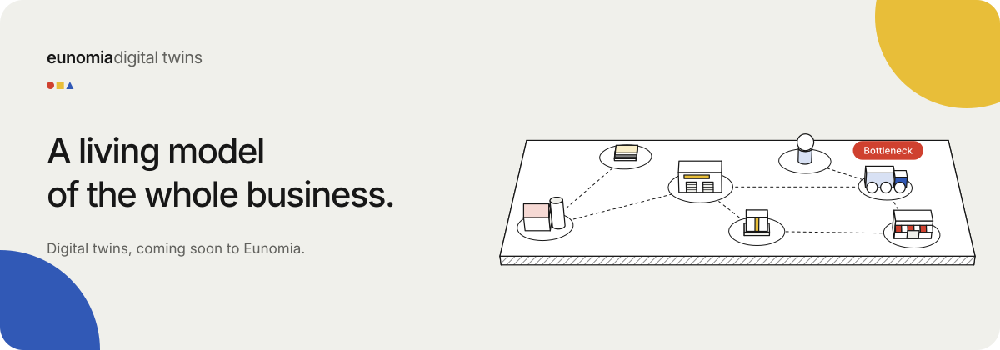
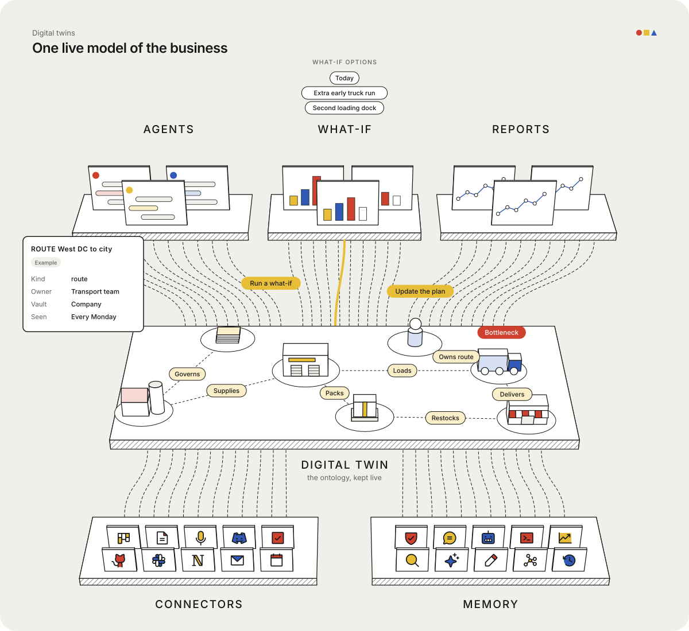
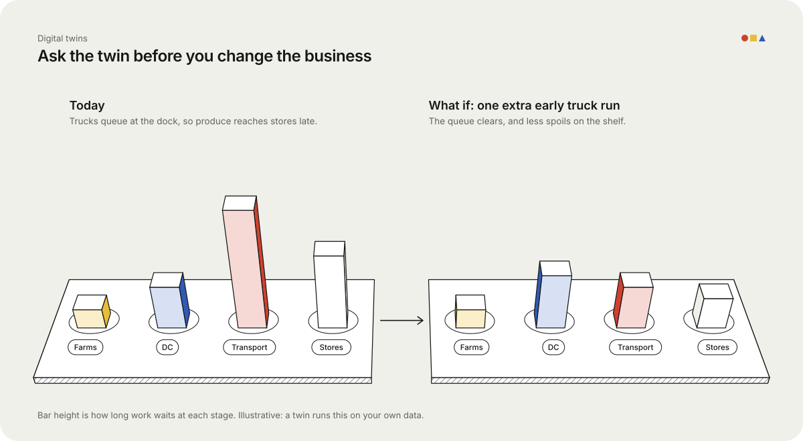

# Digital twins for businesses: a living model you can ask

Factories have used digital twins for years.
A twin is a copy of a machine or a plant that lives in software and moves when the real one moves.
Engineers test a change on the copy first, so the real thing never breaks.

Most businesses never got one.
Their "machine" is people, suppliers, trucks, tickets and spreadsheets, and nobody could model all of that.

Eunomia is built to change that.

> **Coming soon.** Digital twins build on [Ontologies](/eunomia/blogs/ontologies-model-the-whole-business), which are also coming soon.
> Vaults, entities, connectors and recall, the pieces a twin is made from, work in Eunomia today.

## Start with the map: the ontology

An **ontology** is the map of how a business works.
Every stage is an entity: a farm, a distribution centre, a truck route, a store.
Every hand-off is a relation: the farm supplies the centre, the centre loads the trucks, the trucks deliver to the stores.

The [Ontologies post](/eunomia/blogs/ontologies-model-the-whole-business) walks through this for a supermarket chain.
A map like that already helps. People can finally see the whole chain in one place.

But a map is a picture of one moment. The business keeps moving.

## Then keep it live: the digital twin

A **digital twin** is the ontology kept up to date.

- **In the middle is the twin.** The same farms, distribution centre, trucks and stores, joined by the same relations: supplies, loads, delivers. Here it shows the truck route as the bottleneck.
- **Below, it is fed.** Connectors bring in tickets, email, calendars and documents. Eunomia's memory holds what happened before and who decided what.
- **Above, it is used.** AI agents ask it questions, what-if runs test changes on it, and reports read from it.

When a delivery runs late, a ticket is raised or an order changes, the twin changes too.

Because the twin lives in Eunomia's memory, it remembers as well as watches.
It knows that trucks queued at the dock last Monday, and the Monday before, and what the team tried each time.

## Ask it before you change the business

The real value of a twin is the "what if" question.

Say the twin shows trucks waiting at the distribution centre most mornings, and leafy greens spoiling before they sell.
Before you hire drivers or change a contract, you ask the twin:

*"What if we add one extra early truck run?"*

The twin follows the change through the chain.
Trucks stop queueing, so produce reaches stores earlier, so less of it spoils.
You see the knock-on effects on the map, before anything changes in the real world.

The picture above is an illustration. A real twin answers with your own data, and shows where each number came from.

## Why this belongs in Eunomia

A twin needs four things, and Eunomia already has them.

| A twin needs | Eunomia gives it |
|---|---|
| A model of the business | Entities and relations, with your own entity kinds (a route, a dock, a store) |
| Live data | Connectors for tickets, email, calendars, code and more, syncing on a schedule |
| Memory of what happened | Every fact is dated and sourced, so the twin can compare today with last month |
| Safe access | A vault per team, scoped tokens, and an audit log of every change |

And because Eunomia speaks MCP, every AI agent your team uses can ask the twin the same questions a manager would.

## Who it is for

- **Operations leads** who want to see where work gets stuck, without a month of spreadsheet work.
- **Managers** who want to test a change on paper before they test it on the business.
- **AI agents** that run planning, support or reporting, and need the real state of the business, not a guess.

---

*Want a digital twin of your business? Talk to the Eunomia team about Ontologies and digital twins.*
