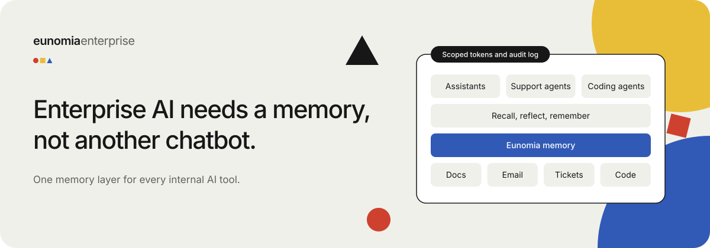
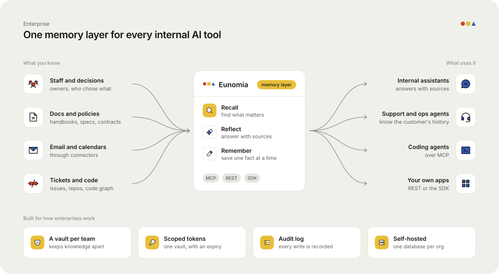

# Enterprise AI needs a memory, not another chatbot

Most companies now run more than one AI tool.
A support assistant. A coding agent. An internal helpdesk bot. A few scripts someone built on a Friday.

Each one starts with an empty head.
Each one is told the same things again: who owns what, what the policy is, what the customer said.
And none of them learns from the others.

That is the gap Eunomia fills.

## One memory layer for every internal AI tool

Eunomia is shared, long-term memory for a company's AI.

- **What you know goes in once.** Staff, documents, email, calendars, tickets and code flow in through connectors, or agents write facts as they work.
- **Every tool reads the same thing.** Agents connect over MCP. Your own apps use the REST API or the Python and TypeScript SDKs.
- **Memory gets better over time.** Raw facts about a person, project or customer are folded into one up-to-date belief, so answers stay current.

## Use cases

### Internal staff and context
A new hire's assistant already knows the team, the tools and the past decisions.
Nobody writes the same onboarding doc twice.

### Internal tooling
The helpdesk bot, the ops agent and the reporting script all recall from the same vaults.
When one learns that a vendor changed terms, the others know too.

### Internal memory for software teams
Coding agents keep a small memory in each repo and share the big picture through Eunomia Cloud.
See [Projects](projects-memory-in-every-repo.md).

### The whole business, mapped
For large operations, we model the business end to end so agents and managers can see where work gets stuck.
See [Ontologies](ontologies-model-the-whole-business.md).

### Your own AI product
Building an app with AI inside? Use the SDK to give it memory per customer, per team or per user, without building a memory system yourself.

## Built for how enterprises work

| Need | How Eunomia handles it |
|---|---|
| Keep teams' knowledge apart | A vault per team, project or client, with owner and member roles |
| Limit what each tool can touch | Tokens scoped to one vault or to read only, with an expiry |
| Know who changed what | Every write is in the audit log |
| Keep data in-house | Self-hosted, and each org gets its own database |
| Use any model | Works with the agent's own model; an OpenAI-compatible endpoint is optional |

## Memory is the layer, not the app

End-to-end AI platforms try to be the whole stack: the agents, the chat, the workflows and the data.
That locks your company's knowledge inside one vendor's product.

Eunomia does one job: memory.
It sits under whichever agents, tools and models you choose, today and next year.
Swap the chatbot. Keep what it learned.

---

*Want one memory for your company's AI? Get in touch with the Eunomia team.*
