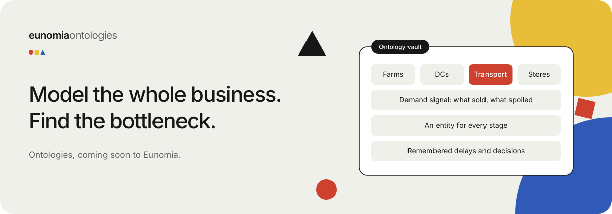
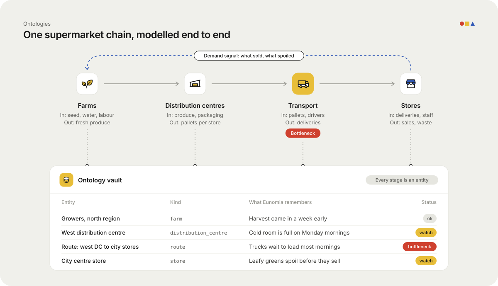

# Ontologies: model the whole business, then find the bottleneck

Big businesses are chains. One team's output is the next team's input.
When something slows down, the cause is often two steps away from where it hurts.

An **ontology** in Eunomia is a map of that chain, held as memory.
Every stage is an entity. Every hand-off is a relation.
Every delay, decision and number is a fact attached to the right place.

> **Coming soon.** Ontologies ship in an upcoming Eunomia release.
> The building blocks below (vaults, custom entity kinds, the graph) are already in Eunomia today.

## The example: a national supermarket chain

Think of a large grocery retailer. Food moves through four stages.

| Stage | What goes in | What comes out |
|---|---|---|
| Farms | Seed, water, labour | Fresh produce |
| Distribution | Produce, packaging | Pallets for each store |
| Transport | Pallets, drivers | On-time deliveries |
| Stores | Deliveries, staff | Sales and waste |

Each stage has its own systems, its own team and its own spreadsheets.
Nobody holds the whole picture in one place. So when the lettuce is late, everyone blames the stage next to them.

## How Eunomia models it

When a business signs on, we model the chain end to end in one **ontology vault**.

1. **Name the things.** Farms, crops, pallets, distribution centres, trucks, routes, stores, shelves, supplier contracts. Each becomes its own entity kind.
2. **Link the hand-offs.** A farm *supplies* a distribution centre. A truck *runs* a route. A route *delivers to* a store.
3. **Attach the facts.** Volumes, wait times, spoilage, who decided what and when. Connectors keep these fresh from the systems the business already uses.
4. **Close the loop.** What sold and what spoiled in store flows back as a demand signal to the farms.

Because it is all one graph, a question can cross stage lines.
"Why was produce waste up in the Northern stores last week?" can walk from shelf, to delivery, to route, to dock, to the farm that shipped it.

## Finding the bottleneck

Once the chain is in one place, the slow link stands out.

In the diagram above, transport is flagged.
Pallets are ready on time, but trucks wait at the dock, so stores get stock late and throw more away.
No single team's dashboard would show that. The chain does.

Agents can work on top of it too:

- An **ops agent** recalls every past delay on a route before it plans tomorrow's runs.
- A **buying agent** checks spoilage at the store end before it orders more from a farm.
- A **manager** asks one question in plain words and gets a cited answer from across the chain.

## Why memory, not another dashboard

A dashboard shows numbers. Eunomia keeps the **why** next to them:
the decision someone made, the supplier who changed terms, the route that was moved.
That context is what an AI agent needs to give a useful answer, not just a chart.

And it stays the business's own. Each org gets its own database, vaults control who sees what, and every change is in the audit log.

## Next: keep the map live

An ontology is the map. A **digital twin** keeps it live, so you can watch the business and test a change before you make it.
See [Digital twins](digital-twins-for-businesses.md).

---

*Want your business mapped end to end? Get in touch with the Eunomia team.*
