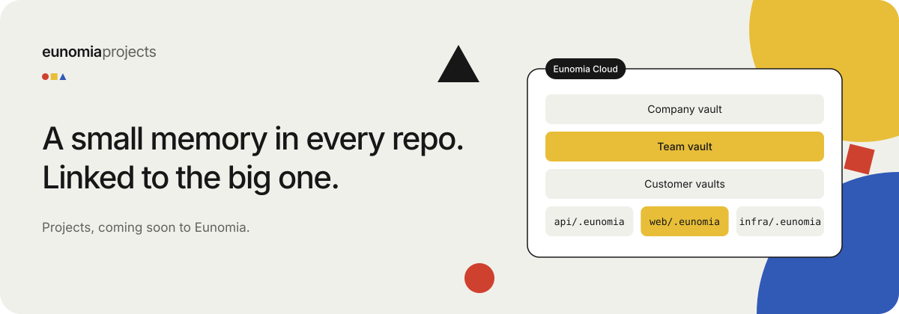
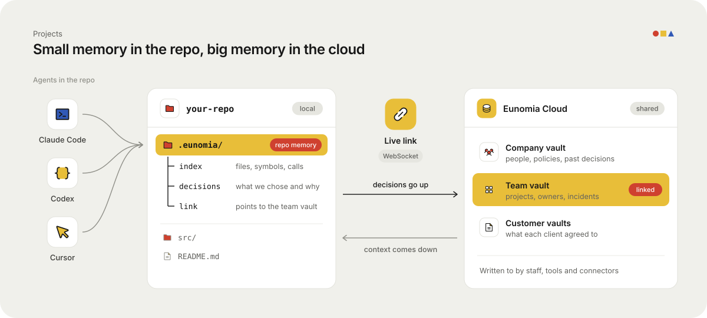

# Projects: a small memory in every repo, linked to the big one

Coding agents are fast, but they forget.
Every new session, they read the same files again, ask the same questions again, and miss the decision you made last month.

**Projects** fix that with two layers of memory.

> **Coming soon.** Projects and the `.eunomia` folder ship in an upcoming Eunomia release.
> Shared vaults, the code graph and MCP access for Claude Code, Codex, Cursor and others work today.

## Layer one: the repo's own memory

Each repository gets a `.eunomia` folder.
It holds the small, local memory for that codebase:

- an index of its files and symbols, and how they call each other
- the decisions and gotchas the team learned the hard way
- a link to the team's vault in Eunomia Cloud

Agents working in the repo read this first. It is close, it is fast, and it is only about this code.

## Layer two: the business's memory

Code is only half the story.
Why does this service exist? Which customer asked for this flag? Who owns billing?
That lives in **Eunomia Cloud**, the company's big, shared memory, split into vaults by team, project or client.

## The live link between them

The `.eunomia` folder keeps a live link (a WebSocket) to Eunomia Cloud.

- **Decisions go up.** When an agent learns something worth keeping, like "we pin this library because of a memory leak", it reaches the team vault. Every other agent and teammate sees it.
- **Context comes down.** When an agent needs business context, like "what did the customer agree to?", it pulls it from the right vault, with access checked on every call.

So an agent in one repo can know what an agent in another repo decided yesterday.
Without anyone copying notes around.

## What is coming

Projects, coming soon:

- **One command per repo:** `npx @eunomia/cli init` makes the `.eunomia` folder, indexes the code and links it to your team vault.
- **How it works:** a live link sends decisions up to the team vault and brings context down from every vault you can read.
- **A code index:** files, symbols and who calls what.
- **A decisions log:** what the team chose and why, read by every agent first.
- **Available today:** Claude Code, Codex, Cursor and other agents already connect over MCP, each with its own token.

## What this looks like for a team

| Without Projects | With Projects |
|---|---|
| Each session starts from zero | The agent opens with what the repo already knows |
| Decisions live in Slack threads and heads | Decisions are written once and found by every agent |
| Agents guess at business rules | Agents recall the rule, with where it came from |
| New starters ask the same questions | New starters (and their agents) read the same memory |

## Works with the agents you already use

Eunomia speaks MCP, so Claude Code, Codex, Cursor, Windsurf, Gemini CLI, OpenCode and VS Code connect the same way.
Each agent gets its own token, which can be limited to one vault and revoked on its own.

---

*Running a software team on AI agents? Talk to us about Projects.*
