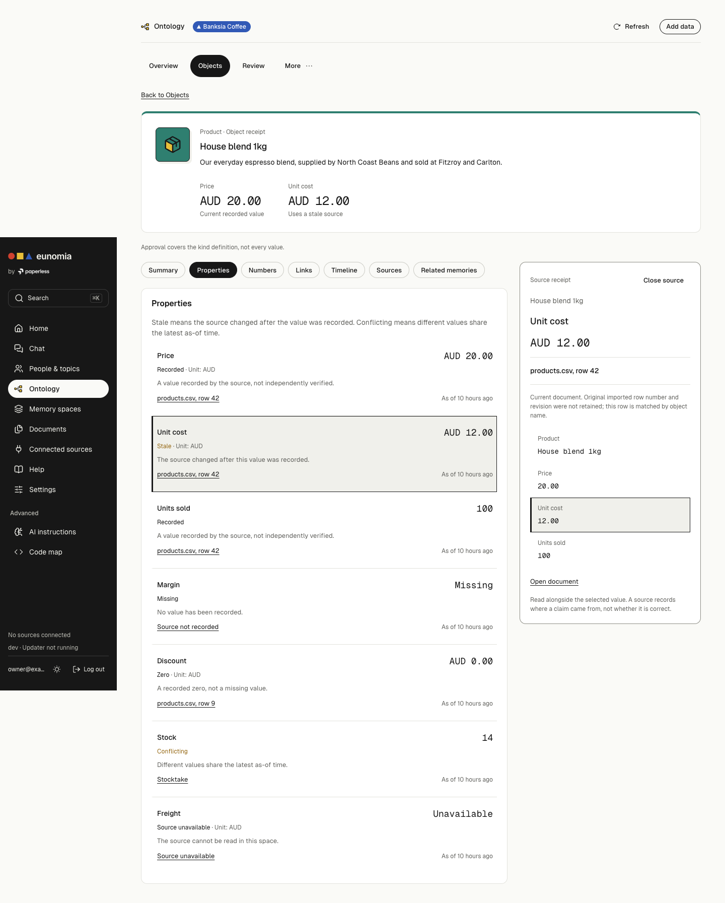
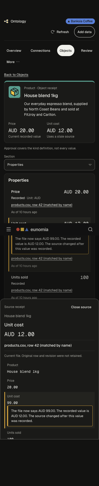
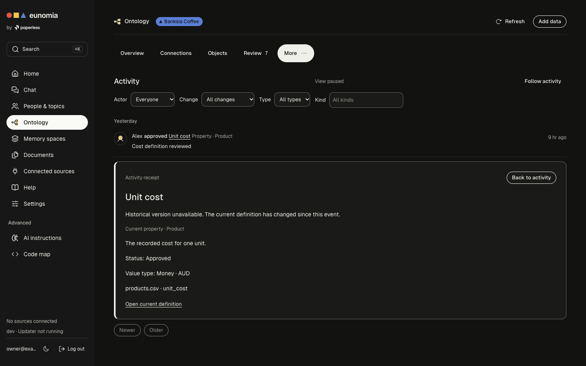

# Object receipts and linked activity

PR C keeps each current object value, its unit, state and source together. A source opens beside the profile on desktop and in a native modal sheet on mobile. The sheet repeats the object and value, contains keyboard focus and closes with Escape. Desktop remains non-modal. Kind colours and Phosphor icons follow the Overview.

## Acceptance evidence

| Acceptance check | Implementation and verification |
| --- | --- |
| House blend unit cost opens the current name match at products.csv row 42 in one action | `ValueReceipts` joins `source` to `sources[].id`. `SourceInspector` uses the returned row, not a filename lookup. Mocked Playwright covers three sources, duplicate products.csv names at rows 42 and 9, a source record and an unavailable source. |
| Back closes source first and restores value focus, then table context | The source is a history entry. Closing or browser Back removes the top layer. The invoking button receives focus. Table URLs retain query, filter and selection. Presentation storage retains scroll positions and the last object section without storing protected text. Playwright covers browser Back, Escape, table query, selection, local horizontal scroll and reopening the last section. |
| Six value states have different words | Recorded, Zero, Missing, Stale, Conflicting and Source unavailable are distinct. A recorded zero is not missing. No verification badge is added. Unit tests and Playwright check the six labels. |
| Activity opens its scoped subject and preserves paused position | Inspection stays within the Activity view and uses the current space. Exact property/kind/metric and unambiguous link definitions resolve by their typed identity. Object events with an entity target open that object. Historical revision mismatch and unresolved subjects say Historical version unavailable. Tests cover current and historical definitions, object targets and pause/focus return. |
| Membership loss removes cached protected panels | An authorised membership read gates the content. Pending and failed checks render no cached receipt. Live membership loss cancels and removes object/activity queries immediately. Stable `vault.forbidden` blocks access. `entity.not_found` reconfirms membership before presenting a missing object. Mocked tests cover pending, denied and failed membership, ambiguous not-found and cross-space source payloads. |
| One selected profile read, no row or metric fan-out | The profile response already contains values, numbers and sources. Source actions do not fetch details or run metrics. Tests assert zero profiles for the directory and exactly one for selection and repeated source inspection. Desktop and mobile interactions are tested separately. |

The mocked visual sweep covers populated, source, duplicate source, source record, unavailable source, loading, empty, failed, denied, missing, links, numbers, activity, selected subject, unavailable history, paused activity, objects and 200% text. Each runs at 1440 and 390 CSS pixels in light and dark themes. The external evidence directory is `/private/tmp/ontology-design/after/pr-c/`; its index pairs each state with a baseline screenshot.

## API limits

- CSV rows are current name matches. The backend explicitly says original imported row numbers and revisions were not retained. Its note stays visible beside the source. This is not historical row provenance.
- Value-write activity currently targets a property definition, without an object ID or historical value. Those events open that exact definition and state the missing object context. The object-target branch is tested with an explicit entity event fixture; it does not claim the current backend emits such events.
- Historical definition versions and evaluator input versions cannot be fetched. Changed definitions say Historical version unavailable. Numbers show current inputs with a clear historical-input limitation.
- Issue #223 remains a backend contract gap. Membership confirmation distinguishes an accessible missing object from an uncertain access outcome; uncertainty never keeps cached source text visible.

## Validation boundary

Use Bun for lint, the unit tests, typecheck and the production build. Browser verification uses a production frontend and `page.route` fixtures. The real-backend Objects and Activity specs have been strengthened for receipt and subject inspection; their execution belongs to CI. No backend, migrations or dependencies are changed. No Cargo commands are run locally. Screenshot and semantic browser checks do not establish VoiceOver/NVDA conformance or a research outcome.

Visual review also found that clipped activity rows contributed invisible page overflow in Chrome. The feed now contains layout and paint, preserving its local scroll area without a long blank page. The paused-scroll regression checks the document height as well as the restored local position.

## Selected figures

Final local checks: lint with all 70 unit tests, TypeScript and production build passed. The final production build passed 41 receipt behaviour and visual tests. The broader mocked regression run passed 165 tests with 96 optional pre-existing figure cases skipped. A subsequent complete state sweep and receipt capture run passed 74 tests. Both real-backend specs are updated for CI; they were not run against a local backend.

The branch was updated after PR #221 merged into main. The lint list retains both receipt and Connections unit tests. The combined frontend passes all 70 unit tests, typecheck and production build. Connections source and navigation were taken unchanged from main.

After updating to current main, 111 production-browser tests passed across receipt behaviour and visual states, Overview, Connections UI and Connections access. The paired captures were refreshed against that combined build.

## Review fixes on 11 November 2026

All CSV row labels now disclose that they are matched by name. Receipt and cell warnings compare typed, unit aware display values through the shared formatter, including money and percent precision. A mismatch uses stale wording when the API marks the value stale. A null row explains duplicate names, removed rows and replacement as possibilities because the API cannot distinguish them. Removed documents remain unavailable.

`SpaceAccess` extracts the Connections state machine. Both entry points pass the space, protected query families and object query families. Receipts also check on entry, focus and membership invalidation. Checking and unknown render no protected DOM text while the stateful owners remain mounted. Ten second checks, backoff, cancellation, attempt generations and space cache eviction are shared. Missing objects are evicted individually after membership confirmation. The space header uses the same gate.

Compact source inspection preserves page and pagination. Import activity navigates to the kind's Objects table because the API offers no import filter. Neutral receipts omit repeated verification prose, mobile values sit beside their labels, and mismatch notices use a labelled text block with a warning border in both themes.

[Issue #231](https://github.com/Cashara-io/eunomia/issues/231) records the remaining backend work. The profile eagerly sends rows and payloads, and `backend/src/documents/mod.rs:465` reads the entire CSV object to return one row. Store row numbers and document revisions during import, then expose a bounded endpoint returning one referenced row on demand. These frontend changes cannot prove historical provenance.

New unit and browser regressions failed before their fixes. Production validation passed typecheck, lint, all 72 unit tests and the build, plus 97 mocked receipt and Connections tests. Connections tests retain their original assertions. The mobile layout regression was also run against the old stylesheet and failed in both themes before passing with the fix. Red and green logs and refreshed screenshots are in `/private/tmp/ontology-design/after/pr-c/`.
